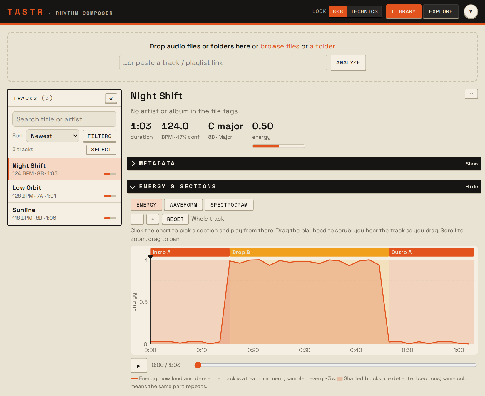
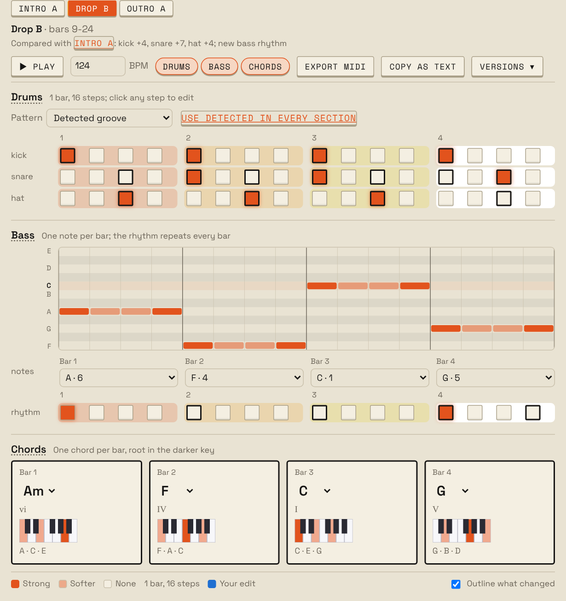
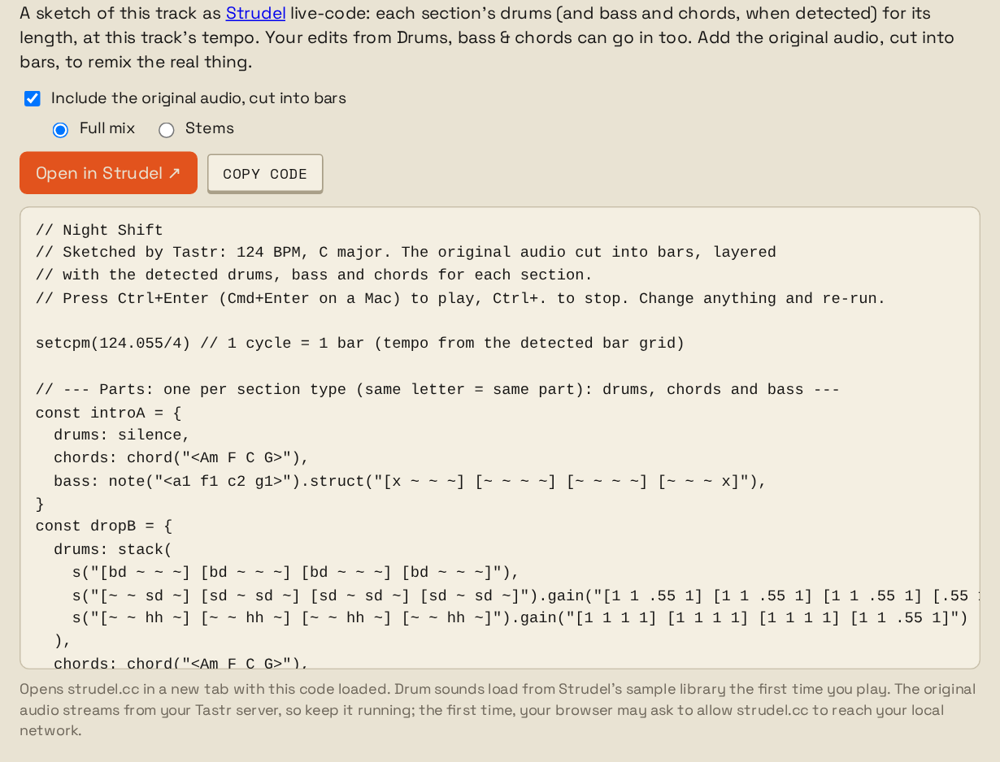
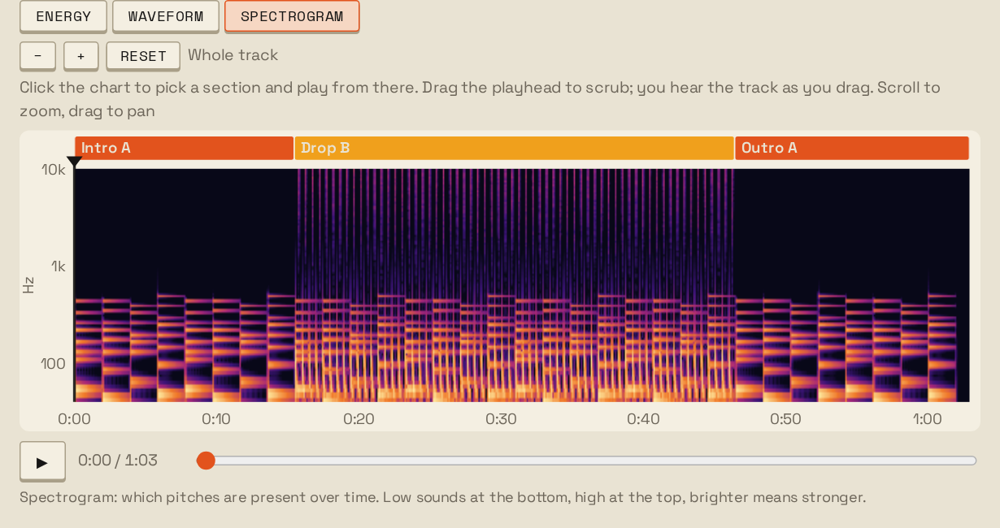
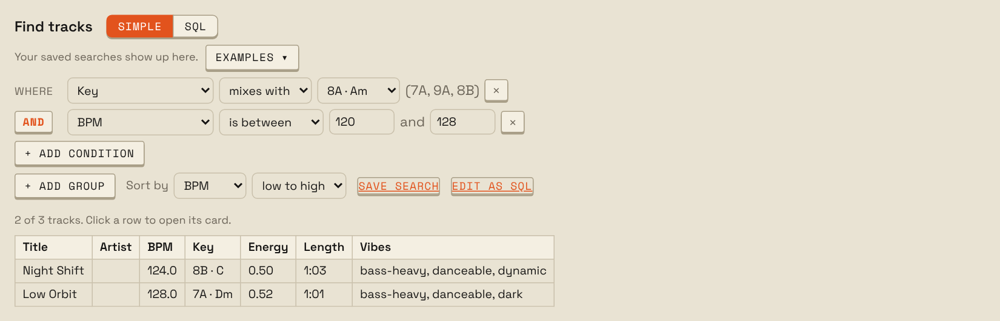
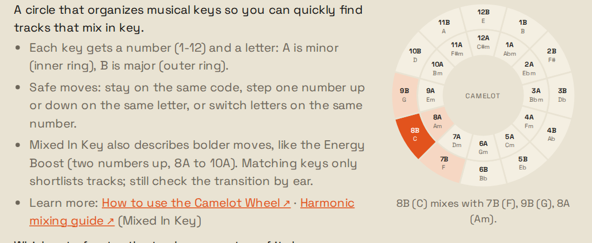

# Tastr

Drop in audio files, folders or track/playlist links and get a **track card**
for each track: tempo, key, energy, sections, vibe, drums, bass and chords,
plus ideas for rebuilding it in Ableton Live or Strudel. Every card lands in a
SQLite database you can search, chart and query with SQL.

Run it on your own machine, or host it for a few invited people behind a login
(see [Hosting for a few people](#hosting-for-a-few-people-optional)). Heavy jobs
(stem separation, benchmarks) can optionally run on a cloud GPU.



## What it does

### Track cards

- **Tempo and key.** BPM with how likely it is to be right (calibrated on the benchmarks), a beat and bar grid, and the
  key from a small learned model trained on GiantSteps and Beatport (shown with
  its Camelot code for mixing). Drum & bass is read at its real tempo, not
  half or two thirds of it.
- **Time signature.** Bars of 4 beats (4/4) or 3 (3/4, waltz time), detected
  from how the beats group. Grids, MIDI and Strudel follow it. When it's wrong,
  change it from the track's ⋯ menu; `TASTR_METER=4/4` turns 3/4 detection off.
  6/8 and songs that change meter are read as 4/4 or 3/4.
- **Energy and sections.** An energy curve with rough section boundaries
  (intro, build, drop, chorus, outro...). Sections that sound alike share a
  letter, so `Drop B` and `Outro B` are the same part.
- **Vibe tags.** Scored tags such as bass-heavy, dark or percussive, grouped by
  kind (energy, mood, rhythm, sound...) and tinted by how strongly they apply.
- **File tags.** Title, artist and album from MP3, FLAC and m4a tags.
- **Listed elsewhere (optional).** The BPM and key that [GetSongBPM](https://getsongbpm.com)
  and FreqBlog (your own API keys) or AcousticBrainz's public-domain dump list for the
  track, shown next to Tastr's figures with a mark when they disagree. Off by default; see
  [docs/lookup.md](docs/lookup.md).

### Drums, bass and chords



- **Drum lanes** for kick, snare, clap, hat, open hat, tom and perc, as a
  16-step grid per section (12 steps in 3/4). Template patterns that fit the
  tempo (waltz patterns in 3/4) are one click away. Ask for the optional drum model (below) on a track and kick, hat and tom come from
  [ADTOF](https://github.com/MZehren/ADTOF), a network trained on annotated
  real music that finds toms the built-in detector misses, and a cymbal lane
  (crash and ride) is added.
- **Per-section bass and chords:** the bass note and rhythm for each bar, the
  chord loop with Roman numerals, and what changed from the previous section
  (marked Δ).
- **Edit and play it.** Click steps, pick bass notes and chords, and hear it
  in the browser with a playhead on every part. Solo or mute each drum lane and
  part, drag the BPM box up or down to change the tempo, and export the parts
  you pick as one MIDI file: the section's loop, or the whole track with every
  section in order.
- **Saved edits and versions.** Edits save automatically with the track. Name
  a version to come back to later. Re-analyzing keeps your edits for sections
  that didn't move.

### Try this in Ableton or Strudel

- **Ableton Live:** setup (tempo, scale, Camelot), drum rack programming, bass
  and chord moves, scales to play over each chord, an arrangement map and mix
  notes.
- **[Strudel](https://strudel.cc):** a live-code sketch of the track with each
  section's drums, bass and chords at the right tempo, written the short way live
  coders type it (`bd*4`, `<Am F C G>`), one named line per layer to mute with `_`,
  filter sliders and a punchcard under the code. It can use your edits and the
  original audio cut into bars, either the full mix or separated stems, and start
  from any section. "Open in Strudel" opens it in strudel.cc, ready to play and remix.



### Listen and explore

- **Energy, waveform and spectrogram views** with playback. Click a section to
  play from there, drag the playhead to scrub (you hear it as you drag), and
  scroll to zoom.
- **Stem separation** into vocals, bass, other and drums with Demucs, on your
  machine or on a [Modal](https://modal.com) GPU (see [Stems](#stems-optional)).
- **Library sidebar** with search, sort and filters by vibe, key and BPM.
- **Track and bulk actions:** copy a summary, reload metadata, re-analyze,
  separate stems or delete, for one track or a whole selection.
- **Explore tab:** a BPM-energy chart, and **Find tracks** to search your library
  without code (BPM, key and the keys that mix with it, energy, vibe, length,
  sections, text, with AND/OR groups), or in read-only SQL with a table and column
  reference. Save the searches you use as one-click chips, or start from the
  examples. "Edit as SQL" shows the SQL behind a search.
- **Two looks:** 808 (a drum-machine panel) and Technics (70s hi-fi), picked
  in the header.
- **Keyboard shortcuts** for most things; press `?` for the list.





### Glossary

A built-in reference for every label, number and pattern on a track card,
and how Tastr works each one out. Open it from the **Glossary** tab, or from
"What the vibes mean" under a track's vibes.

- **Camelot wheel:** click a key to see which keys mix with it. Opening the
  Glossary from a track starts on that track's key.
- **Scales you can hear:** pick a key and scale and play it, or click a row
  of the modes table (Dorian, Phrygian...) to hear that mode.
- **Drum styles:** the pattern ideas for each style, drawn from the engine's
  own templates so they always match what the Pattern picker offers.
- **The rules behind the numbers:** vibe scores, section labels, energy and
  how drums, bass and chords are detected, with the actual thresholds.
- **Accuracy that stays current:** the BPM, key and downbeat scores it quotes
  come from the latest full benchmark run (`tastr bench ... --record`), with
  the run date, so they update without touching the page.



### Measured, not guessed

`tastr bench` scores the engine against labeled datasets (GiantSteps,
Beatport EDM Key, Harmonix, Beat This!, your own tracks), so every analysis
change is judged by numbers. Experiments that worked and the ones that didn't
are written up in [docs/bench.md](docs/bench.md), [docs/drums.md](docs/drums.md)
and [docs/rhythm.md](docs/rhythm.md). See [Accuracy benchmark](#accuracy-benchmark).

Highlights so far:

| Area | Before | Now | Measured on |
|---|---|---|---|
| Exact key, held out | 47.6% | 60.4% | GiantSteps Key, 599 EDM previews |
| BPM within 4% | 0.49 | 0.74 | GiantSteps Tempo, 43 tracks |
| Bar 1 in the right place | 0.43 | 0.64 | GTZAN, 933 songs |
| Toms found (onset F, optional model) | 0.01 | 0.37 | MDB Drums, real mixes |
| Section boundaries within 3 s (F) | 0.48 | 0.58 | Harmonix Set, 912 songs |
| Danceability vs listeners (AUC) | 0.70 | 0.82 | MTG-Jamendo, 510 tracks |

The [analysis engine report](docs/engine-report.md) has every change, the datasets
that found and checked it, and what's still open.

## Quick start

You need Python 3.10 or newer. Check with `python3 --version`. If `python3` is
not found, install Python from [python.org](https://www.python.org/downloads/)
or, on a Mac, run `brew install python`.

From the repo folder:

```bash
python3 -m venv .venv
source .venv/bin/activate
python -m pip install -e '.[dev]'    # use '.[dev,links]' to analyze track/playlist links
tastr serve
```

Then open http://127.0.0.1:8000 in your browser and drop in your audio files.
The web UI is where you analyze tracks and browse their cards.

### Links (optional)

With the `links` extra ([yt-dlp](https://github.com/yt-dlp/yt-dlp)) you can
paste a track or playlist link from YouTube, SoundCloud, Bandcamp, Mixcloud
and other sites that allow downloads. Spotify and Apple Music links don't
work, because those services don't allow downloading audio.

### Hosting for a few people (optional)

Tastr can also run as a small shared web app. Hosted mode (`TASTR_HOSTED=1`, the
`hosted` extra) puts it behind Cloudflare Access for a few invited people:

- every request needs their login (a one-time code sent to their email);
- each person has their own library and sees only the tracks they uploaded;
- link analysis is off, the SQL box reads only your own library, and uploads
  and stem jobs have daily limits;
- uploaded audio and stems are deleted after a while (30 days by default), but
  the track cards stay;
- admins get an **Admin** tab with usage per person and an activity log.

[docs/hosting.md](docs/hosting.md) lists everything hosted mode changes.
[docs/deploy.md](docs/deploy.md) puts it on Fly.io, with analysis and stems on
Modal and the library backed up to R2, and [docs/hosting-map.md](docs/hosting-map.md)
shows how those pieces fit together. Uploads use the built-in drum detector;
"Detect drums with the model" runs the optional drum model on one track at a time.

## Command line

The `tastr` command does the same work from a terminal. Activate the virtualenv
from the Quick start first (`source .venv/bin/activate`).

```bash
tastr analyze ~/Music/some-track.wav ~/Music/folder/
tastr list
tastr show 1                     # full card as JSON
tastr stems 1                    # split track 1 into vocals, bass, other and drums (needs the stems extra, below)
tastr lookup                     # catalog BPM/key for every track (opt-in, docs/lookup.md)
tastr set-owner you@example.com  # give tracks with no owner to a hosted-mode user (docs/hosting.md)
tastr pack library.tar --owner you@example.com  # your library, audio and stems in one file for a hosted server (docs/deploy.md)
tastr unpack library.tar        # on the hosted server, into its empty library
tastr retag                      # re-read file tags for analyzed tracks (`tastr serve` does this once after the tag reader changes)
tastr query "SELECT title, bpm, camelot FROM tracks ORDER BY bpm"
tastr stages                     # pipeline stages in run order
tastr serve --host 127.0.0.1 --port 8000   # web UI (defaults shown)
tastr serve --log-level debug    # also print stage tracebacks and request details
tastr bench synth                # score the engine on labeled tracks (docs/bench.md)
```

The database lives at `~/.tastr/tastr.db`. Override it with `--db` or the
`TASTR_DB` environment variable. The web UI reads the same database.

### Stems (optional)

"Separate stems" in a track's ⋯ menu (or `tastr stems ID`) splits one track into
vocals, bass, other and drums with [Demucs](https://github.com/facebookresearch/demucs)
(`htdemucs`, MIT). The Strudel sketch can then play the stems you pick instead of the
full mix. Demucs needs PyTorch, about 2 GB, so it is an optional install:

```bash
python -m pip install -e '.[stems]'
```

The model weights (about 80 MB) download the first time you separate a track; Demucs 4.1
gets them from the Hugging Face Hub and keeps them in `~/.cache/huggingface`. Later runs
load them from there without going online, so the Hub's "unauthenticated requests ...
set a HF_TOKEN" warning only shows on that first download. A free read token in `HF_TOKEN`
(set in your shell, never in the repo) silences it there too, but isn't needed. It
takes under a minute for a 2-minute track on a recent Mac CPU, and about half that on
its GPU, which is used automatically (as is a CUDA GPU); set `TASTR_STEMS_DEVICE`
to `cpu`, `mps` or `cuda` to choose. Stems are FLAC files in `~/.tastr/stems/` and are
deleted with the track.

### Drum model (optional)

"Detect drums with the model" in a track's ⋯ menu (or the bulk Actions menu)
re-analyzes it in the background with ADTOF's pretrained drum transcription model (Zehren et al.), which also adds a cymbal lane. On real
mixes it finds toms (onset F 0.37 against 0.01 on MDB Drums mixes, 0.88 against
0.00 on unseen StemGMD kits) and scores higher on kick and hats; snare, clap, perc and open hats stay with the built-in detector. It is
slower than the built-in lanes, so everyday analysis doesn't use it; re-analyzing a track that has it keeps it. Details and
scores are in [docs/drums.md](docs/drums.md#pretrained-drum-model-adtof).

```bash
python -m pip install -e '.[drums]'   # PyTorch only; shared with .[stems]
tastr drum-model fetch                 # shows the license, downloads the weights (optional: first use does it too)
tastr drum-model run 1                 # re-analyze track 1 with the model, like the menu item
```

**The weights are CC BY-NC-SA 4.0: non-commercial use only, and share-alike.** They
are not part of Tastr's repository: the first run (or `tastr drum-model fetch`) downloads
them (about 5 MB, from a pinned commit of ADTOF's GitHub repository, checked by SHA-256)
into `~/.tastr/models/`. `TASTR_DRUM_MODEL=adtof` runs the model on every analysis
instead of on request; `TASTR_DRUM_MODEL=off` switches it off.

To run the tests:

```bash
python -m pytest -q
```

`tests/test_strudel_runtime.py` plays the generated Strudel sketches in Strudel itself.
It skips unless Strudel's packages are installed for it (Node 22.15 or newer):
`npm ci --ignore-scripts --prefix tests/strudel-runtime`. CI installs them when the
sketch generator or its tests change.

## Accuracy benchmark

`tastr bench` runs the engine over tracks with known labels and scores BPM,
key, beats, downbeats and sections, so analysis changes are judged by numbers.
Details, metric definitions and dataset setup are in [docs/bench.md](docs/bench.md).

Supported datasets:

| Dataset | Labels |
|---|---|
| `giantsteps-key` | global key (audio from the Zenodo GiantSteps+ mirror, 599 of 604 tracks) |
| `giantsteps-tempo` | global BPM (the mirror covers only 43 of 664 tracks) |
| `beatport-key` | global key (Beatport EDM Key, Zenodo 1101082; 1,275 tracks with a plain major/minor label) |
| `beatport-tempo` | global BPM (Beatport's listed BPM; 774 of the Beatport EDM Key previews) |
| `harmonix` | BPM, beats, downbeats, sections |
| `manifest` | your own tracks, from a CSV or JSON file |
| `synth` | generated tracks; a smoke test that needs no data |

Stage the data in a folder outside the repo (`$TASTR_DATA`, see docs/local-setup.md) and never commit audio; docs/bench.md
shows the layout. Example commands:

```bash
tastr bench synth
tastr bench giantsteps-key ~/data/giantsteps-key --limit 50               # quick check
tastr bench giantsteps-key ~/data/giantsteps-key --jobs 2 --out key.json  # full run, about 46 min
tastr bench giantsteps-key ~/data/giantsteps-key --jobs 2 --baseline key.json
tastr bench manifest ~/music/labels.csv
```

`--limit N` takes the first N tracks, `--jobs` analyzes tracks in parallel (set
`OMP_NUM_THREADS=1` with it), `--out` writes the JSON report, and `--baseline`
compares against an earlier report.

Current key baseline (`--stages core`, learned key model): GiantSteps 599 tracks, MIREX weighted
score 0.676, exact 59.9%; Beatport EDM Key 1,275 tracks, 0.586, exact 49.1%. Both are in-sample (the model was
trained on them); held-out halves score 0.682 and 0.606 (Beatport confidence-2 labels), against 0.650 and 0.562
for the previous Krumhansl-Kessler method. See docs/bench.md "Key detection notes". Tempo results, including the Beat This! spectrogram benches (`tastr spec-bench`), are under "Tempo notes" there.

### Cloud (optional)

Stem separation and benchmarks can run on [Modal](https://modal.com), with
benchmark datasets in a Cloudflare R2 bucket (`python -m pip install -e '.[cloud]'`).
On your own machine the web app and everyday analysis stay local. Setup and costs
are in [docs/cloud.md](docs/cloud.md). A hosted server (above) uses its own Modal
app for analysis and stems.

### README screenshots

The screenshots in this README are generated, not taken by hand, so they follow the UI.

- **How they're made:** `scripts/readme_shots.py` builds a throwaway library of three
  synthetic tracks (nothing touches your own library), starts `tastr serve` on it, and
  `scripts/readme-shots.js` takes each shot with Playwright in the default 808 look: the
  library with an open card, the spectrogram, drums, bass and chords, the Strudel sketch
  and the Glossary's Camelot wheel. They land in `docs/images/`.
- **When they update:** add the `readme-shots` label to a PR that changes how the UI looks.
  After it merges, the `readme-shots` GitHub workflow retakes them on `main` and opens a PR
  with the new images if any changed. It never runs on ordinary pushes, so it only spends
  Actions minutes when the UI changed (details in [docs/ci.md](docs/ci.md#readme-screenshots-workflow)).
- **By hand:** run `python scripts/readme_shots.py` (it needs ffmpeg, node and the
  playwright npm package; see the script). To add a shot, add a step to
  `scripts/readme-shots.js` and an `` here.

## Layout

```
tastr/engine/               the analysis engine; imports nothing else from tastr
  card.py                   TrackCard dataclasses: the contract between modules
  pipeline.py               stage registry, dependency ordering, run_pipeline()
  audio.py                  decoding files to mono audio (librosa, ffmpeg fallback)
  signals.py                shared intermediates (HPSS, onset envelope, chroma, RMS)
  music.py                  key estimation, scales, chords, Camelot
  key_model.py              learned key model constants (generated by bench/train_key.py)
  stages/                   core, sections, tags, suggestions, views (one module each)
  bench/                    accuracy benchmark: dataset loaders, metrics, runner
  bench/key_features.py     cache per-track key features; bench/train_key.py fits the key model
  bench/synth.py            synthetic tracks with known BPM/key/sections (tests/synth.py re-exports it)
tastr/ingest.py             files/folders/links -> Sources, URL resolver registry
tastr/resolvers/            link/playlist resolvers
tastr/lookup/               opt-in catalog lookups (BPM/key by artist + title), one module per provider
tastr/db.py                 SQLite schema and save/load/query
tastr/service.py            inputs -> engine -> DB, used by the CLI and web app
tastr/web/                  FastAPI app and UI; hosted.py is the shared-server mode (docs/hosting.md)
tastr/cloud/                Modal apps: benchmarks and stems (modal_app.py), a hosted server's analysis (modal_web.py)
Dockerfile, fly.toml, deploy/   the hosted server's image, Fly.io config and Litestream backup (docs/deploy.md)
```

The engine is kept self-contained so it can be split into its own library
later; `tests/test_engine.py` fails if it starts importing app code. Use it
directly with `from tastr.engine import analyze_file`.

Read `docs/ARCHITECTURE.md` for the data flow, card fields, feature names and
DB tables, `docs/modules/` for per-module specs, and `docs/hosting-map.md` for how the
hosted setup (Cloudflare, Fly.io, Modal, R2) fits together.

## Licenses

Tastr's code is under the MIT License ([LICENSE](LICENSE)). Security reports: see
[SECURITY.md](SECURITY.md).

Two generated files hold numbers fitted on public datasets, so they also carry the
datasets' terms:

- `tastr/engine/key_model.py` (the learned key model) was fitted on GiantSteps Key and
  the Beatport EDM Key dataset (Zenodo 1101082), both CC BY-SA 4.0. Treat these weights
  as derived from that data: credit the datasets and share changes to the weights alike.
- `tastr/engine/calibration_table.py` (the "N% likely right" tables) was fitted on
  GiantSteps and Beatport tempo/key results and HJDB from the Beat This! release
  (Zenodo 13922116, CC BY 4.0).

Third-party pieces it uses or links to:

- **mutagen** (file tags, a required dependency) is GPL-2.0-or-later. Tastr doesn't
  bundle it; pip installs it alongside.

- **Strudel** is AGPL-3.0. Tastr doesn't bundle it: "Open in Strudel" opens
  the generated sketch on strudel.cc. The optional sketch tests install Strudel's
  packages under `tests/strudel-runtime/` to play the sketches; they are never
  shipped with Tastr (not in the package or the Docker image).
- Ideas in the Strudel sketch (short mini-notation, sliders, the punchcard, named
  lines, sidechain and wobble, testing against Strudel itself) come from
  [Toaster](https://github.com/StopBanning/toaster) (MIT). No code was copied.
- **Demucs** (stems) is MIT. It is an optional install, and its model weights
  download on first use.
- **yt-dlp** (links) is under the Unlicense, also optional.
- **Catalog lookups** (optional, your own API keys): [GetSongBPM](https://getsongbpm.com)
  requires a link back wherever its data is shown, which the card does. FreqBlog's API
  allows storing results only on paid plans, so Tastr keeps them only with
  `FREQBLOG_PLAN=paid`. [AcousticBrainz](https://acousticbrainz.org) dumps and
  [MusicBrainz](https://musicbrainz.org) core data are public domain (CC0); Tastr reads a
  local index of the 2022 AcousticBrainz dump. See [docs/lookup.md](docs/lookup.md).
- **ADTOF** (optional drum model): its code and model weights are **CC BY-NC-SA
  4.0, non-commercial and share-alike**. Tastr doesn't include either. The weights
  download on first use from the ADTOF repository; the network and preprocessing
  that run them are Tastr's own code, written from the paper's architecture.
  [ADTOF](https://github.com/MZehren/ADTOF): M. Zehren, M. Alunno, P. Bientinesi,
  "High-Quality and Reproducible Automatic Drum Transcription from Crowdsourced
  Data", Signals 4(4), 2023.
- **Benchmark datasets** each have their own license, listed in
  [docs/datasets.md](docs/datasets.md). Some don't allow redistribution, so
  audio and labels are never committed to this repo.
