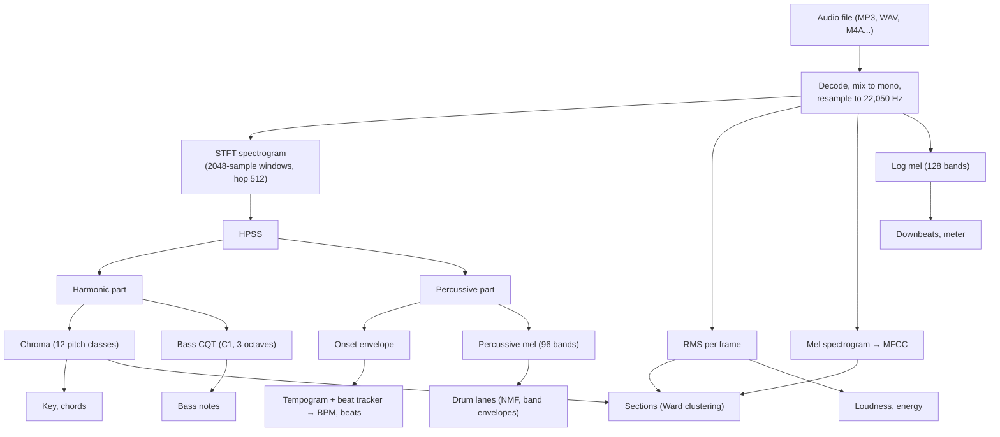
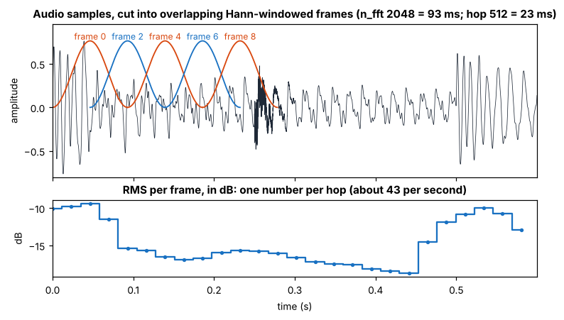
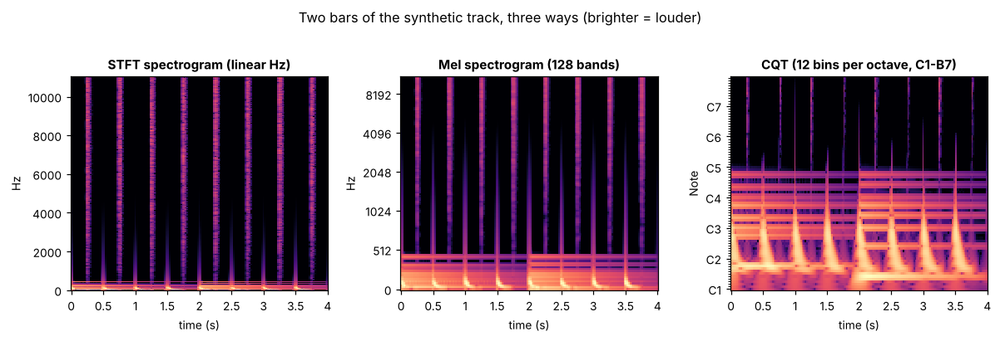
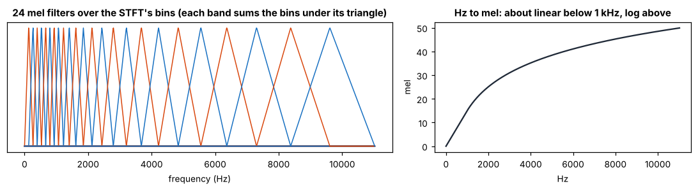
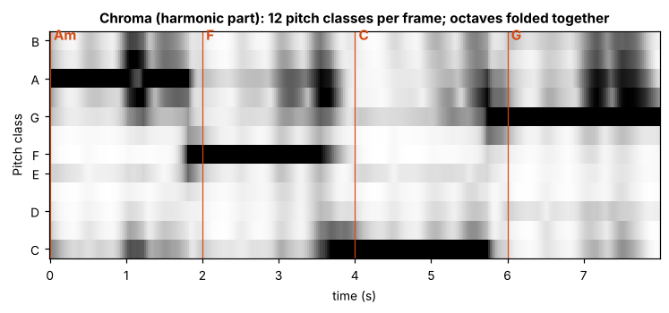
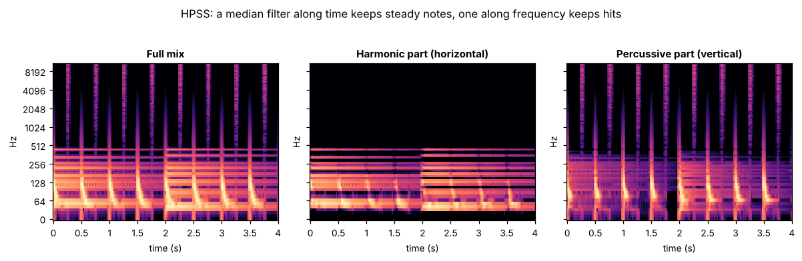
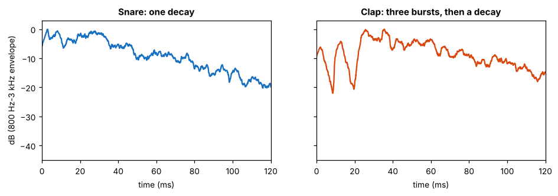
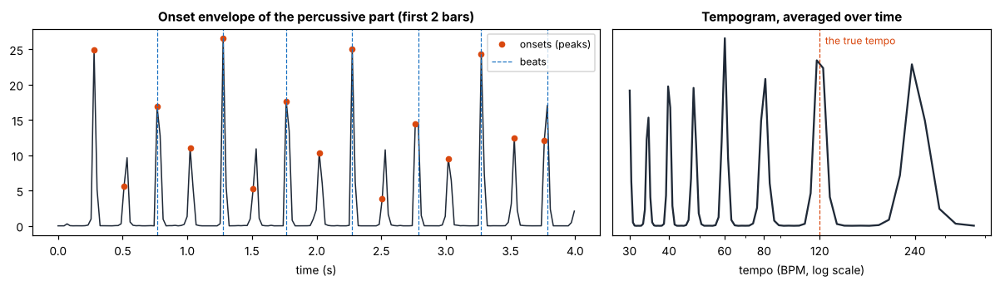
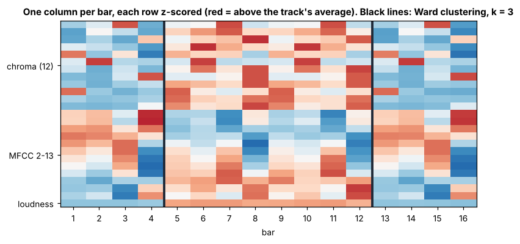

# Audio analysis terms, for software engineers

The engine docs, the code and the benchmarks use a lot of signal-processing vocabulary: STFT, mel, MFCC,
CQT, chroma, HPSS, onset envelope, tempogram, Ward clustering. This page explains each of them for someone
who writes software but hasn't studied audio. Each entry says what the thing is, gives an intuition, and says
where Tastr uses it and with what settings. The in-app Glossary explains what the *results* mean to a
musician (BPM, key, Camelot, vibes); this page explains the *machinery* underneath.

Every figure here is drawn from a synthetic track (`tastr.engine.bench.synth.make_track`: a minor-key chord
progression, a bass line, a kick on every beat and off-beat hats at 120 BPM) with the engine's own settings.
`python scripts/terms_figures.py` redraws them.

**Contents**

1. [The pipeline at a glance](#1-the-pipeline-at-a-glance)
2. [Sound as numbers](#2-sound-as-numbers): sample, sample rate, Nyquist, resampling, decibels, RMS
3. [Frames, hops and windows](#3-frames-hops-and-windows)
4. [From time to frequency](#4-from-time-to-frequency): Fourier transform, FFT, STFT, spectrogram, bins
5. [Frequency scales that match hearing](#5-frequency-scales-that-match-hearing): mel, log mel, MFCC, CQT,
   chroma, spectral centroid
6. [Pulling a mix apart](#6-pulling-a-mix-apart): HPSS, masks, NMF, filters, drum envelopes, stems, drum models
7. [Rhythm](#7-rhythm): onsets, onset envelope, peak picking, tempogram, beat tracking, downbeats, pulse
   clarity, swing
8. [Harmony](#8-harmony): pitch class, key profile, chord templates
9. [Structure](#9-structure): per-bar features, z-scores, Ward clustering
10. [Where it runs](#10-where-it-runs): librosa, the Rust/WebAssembly engine, Web Audio
11. [Quick reference](#11-quick-reference)
12. [Sources and further reading](#12-sources-and-further-reading)

## 1. The pipeline at a glance

Read top to bottom: a file becomes a list of numbers, then a few shared "views" of those numbers, and each
part of the track card reads the views it needs. The shared views live in
[`tastr/engine/signals.py`](../tastr/engine/signals.py) and are computed once per track.

## 2. Sound as numbers

**Sample.** A microphone or a synth produces air pressure that goes up and down. Digital audio measures that
pressure many times a second and stores each measurement as a number, usually between -1 and 1. One number
is a *sample*. A stereo file stores two streams of samples; Tastr averages them into one (*mono*), because
none of its measurements depend on left versus right.

**Sample rate.** How many samples per second. CDs and most MP3s use 44,100 Hz (44.1 kHz); video often
48,000 Hz. Tastr analyzes at **22,050 Hz** (`ctx.sr`), half the CD rate, which halves the work.

**Nyquist frequency.** A sample rate can only represent frequencies up to half of itself, because you need at
least two samples per cycle to tell a wave is there. At 22,050 Hz the ceiling is 11,025 Hz. That drops the
very top of cymbals and "air", but everything that decides tempo, key, chords and structure sits far below
it. (Faster content doesn't vanish cleanly: it folds back as false lower tones, called *aliasing*, unless it
is filtered out first. That is the resampler's job.)

**Resampling.** Converting audio from one sample rate to another, here 44.1 or 48 kHz down to 22.05 kHz. A
good resampler first removes the content above the new Nyquist frequency with a low-pass filter, then picks
or interpolates the new samples. librosa (via the soxr library) does this when it loads a file. The Rust
engine has its own resampler ([`engine-rs/src/resample.rs`](../engine-rs/src/resample.rs)): a *Kaiser-windowed
sinc* filter (the textbook ideal low-pass shape, trimmed to a finite length) that is flat up to 91.3% of the
new Nyquist and about 120 dB down by Nyquist, written so a native build and a browser build give
bit-identical output ([rust-engine.md](rust-engine.md)).

**Amplitude and decibels (dB).** Amplitude is how big the samples are. Hearing is roughly logarithmic, so
levels are quoted in decibels: dB = 20 · log10(amplitude / reference) for amplitudes, 10 · log10 for
power. Every +6 dB doubles the amplitude; every +20 dB multiplies it by 10. **dBFS** ("decibels relative to
full scale") uses the loudest possible sample (1.0) as the reference, so digital levels are 0 dBFS or
below. A mastered club track averages around -8 to -12 dBFS.

**RMS (root mean square).** The standard way to say "how loud is this stretch of audio": square each sample,
take the mean, take the square root. Squaring makes negative and positive swings count the same. Tastr
computes RMS per frame (next section) with `librosa.feature.rms` and converts it to dB. It feeds
**loudness** (the whole-file RMS in dB), the per-bar **energy chart**, `dynamic_range_db` (the 95th minus
10th percentile of frame RMS in dB) and one row of the section features. The lower half of the figure in
§3 is RMS.

## 3. Frames, hops and windows

Almost every measurement works on short slices of audio instead of the whole file, because music changes from
moment to moment.

- A **frame** is one slice. Tastr's spectral frames are 2048 samples long (93 ms at 22,050 Hz).
- The **hop** is how far the next frame starts after the previous one: 512 samples (23 ms), so frames overlap
  by three quarters and you get about **43 frames per second**. Every per-frame array in the engine
  (onset envelope, chroma, RMS, MFCC) has one column per hop, and `frame_times` converts column numbers to
  seconds (`column × 512 / 22,050`).
- A **window** is a bell-shaped curve multiplied into each frame before analysis. Chopping audio with hard
  edges creates false frequencies (*spectral leakage*); tapering the frame to zero at both ends avoids most
  of it. Tastr uses the **Hann** window (librosa's default, and the one the browser's sharp spectrogram tiles
  use). Overlapping frames make up for the window throwing away the frame edges.

The trade-off to remember: **longer frames see pitch more precisely but blur timing; shorter frames see timing
precisely but blur pitch.** (This is the audio version of the uncertainty principle.) It is why the engine
uses different representations for different jobs, and why the Live spectrogram view runs two analysers at
once: a short FFT for crisp timing in the highs and a long one for detail in the bass, crossfaded between 150
and 900 Hz.

## 4. From time to frequency

**Fourier transform.** Any chunk of sound can be described as a sum of pure sine waves of different
frequencies, each with its own strength (*magnitude*) and starting point (*phase*). The Fourier transform
finds those frequencies and strengths. For an engineer, the useful mental model: it correlates the signal
with a sine wave at each frequency and reports how well each one matches.

**FFT (fast Fourier transform).** The O(n log n) algorithm that computes the discrete Fourier transform of a
frame. "FFT size" usually just means the frame length. Tastr's FFT size is 2048 samples (`n_fft`).

**Frequency bin.** An FFT of N samples gives N/2 + 1 evenly spaced frequencies, the *bins*, from 0 Hz to
Nyquist. Bin spacing is sample rate / N: 22,050 / 2048 ≈ **10.8 Hz**. That is plenty for a hi-hat but
coarse in the bass, where neighbouring notes (E1 = 41.2 Hz, F1 = 43.7 Hz) are less than 3 Hz apart and land in
the same bin. Section 5 shows the fixes.

**STFT (short-time Fourier transform).** An FFT of every frame, side by side. The result is a 2-D array:
one row per frequency bin, one column per hop. Each cell is a complex number; its absolute value is the
*magnitude*, its square the *power*, its angle the *phase*. Most analysis keeps only magnitude or power;
phase is needed only to turn a spectrogram back into audio (the *inverse STFT*, which HPSS uses).

**Spectrogram.** A picture of the STFT magnitude: time left to right, frequency bottom to top, loudness as
brightness. It is what the Spectrogram and Live views in the app draw, and the starting point for nearly
everything else here.

**Log compression.** Raw magnitudes span a huge range (a kick can be 10,000 times stronger than a hat's top
end), so spectrograms are usually converted to dB (`librosa.power_to_db` / `amplitude_to_db`) or squashed with
`log(1 + C · x)` (the `log_mel` signal uses `log1p(1000 · magnitude)`, like the Beat This! model). Both make
quiet detail visible and make differences behave more like what we hear.

In the left panel, all the musical notes are squeezed into the bottom sliver of the image, because a linear
frequency axis spends most of its height on treble. The hats are the vertical stripes reaching the top; the
kicks are the bright blobs at the bottom.

## 5. Frequency scales that match hearing

We hear pitch logarithmically: each octave doubles the frequency (A2 = 110 Hz, A3 = 220 Hz, A4 = 440 Hz), and
we notice a 10 Hz change at 100 Hz but not at 10 kHz. The representations below regroup or recompute the
spectrum on scales closer to that.

**Mel scale.** A perceptual pitch scale from listening experiments in the 1930s: roughly linear below 1 kHz,
logarithmic above. Equal steps in mel sound like roughly equal steps in pitch.

**Mel spectrogram.** The STFT power, pooled into bands that are evenly spaced in mel: a set of overlapping
triangular filters, narrow in the bass and wide in the treble, each summing the bins under it. 1,025 bins
become 96 or 128 bands. It is a smaller, more hearing-like spectrogram, the standard input for ML audio
models. Tastr uses three: the full mix with 128 bands for MFCC (`signals.mfcc`), the percussive part with 96
bands for drums (`signals.mel_percussive`), and a 128-band 30 Hz to 11 kHz **log mel** for downbeats and
meter (`signals.log_mel`, shaped like Beat This!'s input so their labeled data applies).

**MFCC (mel-frequency cepstral coefficients).** A compact description of *timbre*, the "what does it sound
like" quality that tells a piano from a guitar at the same pitch. Take the log mel spectrum of a frame and
run a DCT (discrete cosine transform, a cousin of the FFT) over its bands. The first coefficient is the
overall level; the next few describe the broad shape of the spectrum (bass-heavy or bright, smooth or
peaky), and the rest describe finer ripples. The fine pitch detail ends up in the coefficients that are
dropped, so MFCCs mostly ignore which notes are played. Tastr keeps 13 and, in the section features, uses
2 to 13 (dropping the level one, which RMS already covers). Born in speech recognition in 1980; still the
default timbre feature in music analysis.

**CQT (constant-Q transform).** A spectrum whose bins are spaced like piano keys instead of evenly in Hz:
here 12 bins per octave, one per semitone, starting at a chosen note. Low bins use long analysis windows
(fine pitch, slow timing), high bins short ones, so each bin has the same *Q*: the ratio of its center
frequency to its bandwidth. That solves the 10.8 Hz bin problem in the bass. Tastr's **bass CQT**
(`signals.bass_cqt`) covers C1 to B3, 36 bins, on the harmonic part, and the bass-notes suggestions read it
bar by bar. In the right panel of the figure above, each note of the chord and bass is its own horizontal
line. The Rust engine has its own CQT ([`engine-rs/src/cqt.rs`](../engine-rs/src/cqt.rs)); most of its cost is
the resampling it does to analyze each octave at a lower rate.

**Chroma (pitch class profile, chromagram).** Fold all octaves of a CQT together: every C (C1, C2, C3...) adds
into one "C" row, every C♯ into "C♯", and so on, giving **12 rows**, one per pitch class. It answers "which
notes are sounding right now", ignoring octave and mostly ignoring timbre, which is exactly what key and chord
detection need. Tastr computes it on the harmonic part with `librosa.feature.chroma_cqt` (`signals.chroma`).

The synth plays Am, F, C, G, one chord per bar; the darkest row in each bar is the chord's root, which the
bass doubles.

**Spectral centroid.** The "center of mass" of a frame's spectrum: the magnitude-weighted average frequency.
Bright, trebly sounds have a high centroid; dull or bassy ones a low one. Tastr's **brightness** feature is
the mean centroid divided by 3,500 Hz, clipped to 0..1. It feeds track energy, the dark and bright vibes and
the mix tip. **low_end** is the share of STFT power below 150 Hz.

## 6. Pulling a mix apart

A mixed track is everything at once. Several steps separate it into parts that are easier to measure.

**HPSS (harmonic-percussive source separation).** In a spectrogram, sustained notes are *horizontal* lines
(one frequency held over time) and drum hits are *vertical* lines (a short burst across many frequencies).
HPSS exploits that. A **median filter** replaces each cell with the median of its neighbours: run along time,
it keeps horizontal lines and erases short spikes; run along frequency, it keeps vertical lines and erases
narrow peaks. Comparing the two filtered spectrograms tells, cell by cell, how "harmonic" or "percussive" the
energy there is. Those shares become **soft masks** (each cell's harmonic and percussive weights add up to 1),
and multiplying the original spectrogram by each mask and running the inverse STFT gives two audio signals
that add back up to the input.

Tastr runs HPSS once per track (`signals.hpss`, librosa's defaults: 31-cell median filters, power-2 masks)
and almost everything downstream reads one of the two parts: chroma and the bass CQT read the harmonic part,
onsets and drums the percussive part. **percussiveness** is the percussive part's share of the total energy.
HPSS used to be about 70% of a track's analysis time, mostly the 2-D median filter; filtering row by row is
3x faster with the same output ([ARCHITECTURE.md](ARCHITECTURE.md)), and it can run in the visitor's browser
instead ("Browser signals" in the same doc).

**NMF (non-negative matrix factorization).** Approximates a spectrogram V (frequencies × time) as W × H: W
holds a few spectral *templates* (what each source sounds like), H holds their *activations* over time (when
and how loud each one plays). All entries stay non-negative, which matches how sounds add up in a spectrogram.
Tastr's drum detector ([`tastr/engine/drums.py`](../tastr/engine/drums.py), [drums.md](drums.md)) factors the
percussive mel spectrogram into three parts (low = kick, mid = snare/clap/perc, high = hats) starting from
hand-made templates that may adapt only partway, so a part can't drift into another drum. Each part's
activation row is that drum's onset signal.

**Filters (low-pass, high-pass, band-pass) and Butterworth.** A filter keeps some frequencies and removes
others: low-pass keeps the bass, high-pass the treble, band-pass a range. A **Butterworth** filter is a classic
design that is as flat as possible in the kept range; "4th order" sets how steeply it cuts off outside it.
`sosfiltfilt` runs the filter forward and then backward, which cancels its time delay (*zero-phase*), so a
hit's envelope doesn't shift late.

**Drum envelopes.** An *envelope* is the outline of a signal's loudness over time, ignoring the individual
wiggles: rectify (absolute value), smooth, convert to dB. Tastr keeps two from the percussive part at full
time resolution (`drums._envelopes`): **mid** (800 Hz to 3 kHz band-pass) and **air** (above 6 kHz),
each smoothed over 4 ms. Their shape sorts hits into lanes. A **clap** is several hands a few milliseconds
apart, so its mid envelope shows three or more quick bursts at least 6 dB apart; a **snare** shows one
attack. An **open hat** keeps ringing in the air band (falls less than about 10 dB in 90 ms); a closed hat
dies quickly.

**Air band and band flux.** "Air" is mixing slang for the top octave or so, above about 6 kHz, where hats and
cymbals live and little else does. *Flux* means "how much did this band just get louder": `drums._air_flux`
(hats) and `signals.low_band_flux` (20 to 150 Hz, the kick) measure the rise in dB from one frame to the next
in just that band. See onset strength below.

**Stems.** Separate audio files for each instrument group (vocals, drums, bass, other). Tastr makes them on
request with **Demucs** (`htdemucs`), a neural network trained to un-mix music ([`tastr/stems.py`](../tastr/stems.py)).
HPSS is a fast, rough two-way cousin of this.

**ADT (automatic drum transcription).** Turning audio into drum hits per instrument, like a MIDI drum part.
Tastr's built-in detector is the NMF-plus-envelopes method above; the optional **ADTOF** model (Zehren et
al., a convolutional-recurrent network trained on about 360 hours of music) is used for some lanes when
installed ([`tastr/engine/adt.py`](../tastr/engine/adt.py)).

## 7. Rhythm

**Onset.** The start of a note or hit: the moment something new begins to sound. Drums give sharp onsets; a
slow string swell gives a soft one.

**Onset strength and spectral flux.** A per-frame number for "how much new sound just started". The standard
recipe (librosa's `onset_strength`): take a log mel spectrogram, compute for each band how much louder it got
since the previous frame, ignore bands that got quieter (only rises count), and average across bands. That is
*spectral flux*. A hit raises many bands at once and scores high; a sustained note scores near zero after its
start.

**Onset envelope.** The onset strength for every frame, as a 1-D time series (`signals.onset_envelope`,
computed on the percussive part). It is the single most important rhythm signal in the engine: tempo, beats,
pulse clarity and swing all read it.

**Peak picking.** Turning a curve into a list of events by finding its local maxima that stand out enough from
their neighbourhood. `librosa.onset.onset_detect` peak-picks the onset envelope; the count per second is the
**onset_rate** feature (25% of track energy). The drum detector peak-picks each lane's activation.

**Autocorrelation.** Compare a signal with a delayed copy of itself, for every delay (*lag*). Where the copy
lines up with the original, the score is high. A beat repeating every 0.5 s gives a peak at lag 0.5 s, that
is, 120 BPM.

**Tempogram.** Autocorrelation of the onset envelope, computed in a sliding window over time (librosa's
`tempogram`, 384 frames ≈ 8.9 s), with each lag converted to BPM. It shows which tempos the rhythm supports
and how that changes over the track. Averaged over the track (right panel above), it has peaks at the true
tempo, but also at **multiples and fractions** of it: 240 BPM (the off-beat hats, every half beat), 60 BPM
(every 2 beats), 40, 30 (every 3 or 4 beats), and in between. That is why tempo estimators make
**octave errors**, reading 87 instead of 174, and why the card keeps half and double tempo as alternatives.
Tastr reads the tempogram to decide whether to switch to 1.5x the tracked tempo (`core._periodicity`) and the
benchmark notes in [engine-report.md](engine-report.md) discuss its limits.

**Beat tracking (dynamic programming).** Picking the actual beat times, not just the tempo.
`librosa.beat.beat_track` uses Ellis's 2007 method: estimate a global tempo from the tempogram, then choose the
sequence of beat times that best balances two goals: land on strong onsets, and keep the gaps between beats
close to the tempo. *Dynamic programming* is the same technique as edit distance: build the best answer for
every prefix of the track, keep a back-pointer, and trace back from the end. Tastr then refines the BPM from
the median beat gap, and when the beats are steady enough, replaces them with a perfectly even grid
(`core._regularize`), which also fills in breakdowns with no drums.

**Downbeat, bar and meter.** The downbeat is beat 1 of a bar; meter is how many beats a bar has (Tastr: 4 or
3). Neither shows up in the onset envelope of four-on-the-floor music, where every beat has the same kick.
Tastr scores each candidate phase with five cues read from the log mel spectrogram (kick, backbeat, timbre or
chord change, bass change, bar-to-bar change) and z-scores and sums them ([rhythm.md](rhythm.md)).

**Pulse clarity.** How strongly the onsets line up with the tracked beats: the mean onset strength on beats,
relative to the mean everywhere. High for a four-on-the-floor track, low for ambient music. It is half of
the BPM confidence score.

**Swing.** In straight time, the off-beat 16th note falls exactly halfway through each 8th; in swung time it
is late. Tastr looks for the strongest onset in the 18% to 42% stretch of each beat, refines its position with
**parabolic interpolation** (fit a parabola through the peak frame and its two neighbours, and take the
vertex, for sub-frame precision), and reports where it lands as a percentage: 50 is straight, about 66.7 a
triplet shuffle. That number maps directly onto the Swing setting in Ableton's Groove Pool.

## 8. Harmony

**Pitch class.** A note name without its octave: all Cs are pitch class C. Twelve pitch classes per octave;
chroma has one row for each.

**Key profile.** A track's chroma averaged over time (each frame normalized first so loud frames don't
dominate): a 12-number summary of how much each pitch class is used (`music.key_profile`). The classic way to
find the key is to compare the profile with a template for each of the 24 keys, such as the
**Krumhansl-Kessler** profiles from 1982 listening experiments, and pick the best match. Tastr started there
and now uses a small learned model (a softmax over the 24 keys, trained on GiantSteps and Beatport EDM Key),
which made fewer relative major/minor errors ([bench.md](bench.md), [engine-report.md](engine-report.md)).

**Chord templates.** Same idea per bar: a chord is a set of pitch classes (C major = C, E, G), written as a
12-number template, and the bar's mean chroma is matched to the closest template by cosine similarity
(`music.match_chord`).

**Camelot and scales** are musical, not signal-processing, terms; the in-app Glossary covers them.

## 9. Structure

**Per-bar features.** Sections are found bar by bar, not frame by frame. For each bar, Tastr averages chroma (12
numbers: the harmony), MFCC 2 to 13 (12 numbers: the timbre) and RMS in dB (1 number: the level) into one
column of 25 numbers (`sections._bar_vectors`).

**Z-score (standardization).** Subtract a feature's mean and divide by its standard deviation, so every row is
measured in "standard deviations from this track's average". Without it, the feature with the largest raw
numbers (here the dB level) would dominate any distance between bars.

**Agglomerative clustering and Ward's method.** Bottom-up clustering: start with every bar as its own cluster
and repeatedly merge the two clusters whose merge adds the least spread. **Ward's method** defines that cost as
the increase in total within-cluster variance (the sum of squared distances to each cluster's mean), which
tends to produce compact, evenly sized groups. librosa's `segment.agglomerative` adds one constraint: only
*neighbouring* bars may merge, so every cluster is a contiguous stretch of time, a section. Tastr asks for
k = duration / 18 s sections (3 to 12, tuned on Harmonix in [bench.md](bench.md#sections)), then snaps
boundaries to 2-bar multiples.

After clustering, sections that sound alike get the same **letter** (A, B...): two sections share a letter when
the root-mean-square difference of their mean feature columns is under 0.55. The labels (intro, drop,
breakdown...) come from relative energy, as the Glossary describes.

## 10. Where it runs

- **librosa** is the Python library behind most of the engine: loading, STFT, mel, MFCC, CQT, chroma, HPSS,
  onsets, tempogram, beat tracking, segmentation. Its documentation is a good reference for every term here.
- **The Rust engine** ([rust-engine.md](rust-engine.md), `engine-rs/`) reimplements the same steps
  (`spectral.rs`, `cqt.rs`, `rhythm.rs`, `segment.rs`, `resample.rs`) to match librosa closely, and compiles to
  **WebAssembly** so whole cards can be computed in the browser.
- **Web Audio** is the browser's audio API. The app decodes files with `decodeAudioData`; with browser signals
  on, it decodes uploads through an `OfflineAudioContext` at 22,050 Hz (decode and resample without playing)
  before running HPSS in a worker. The Live view reads an **`AnalyserNode`**, which hands back an FFT of
  whatever is playing, many times a second. The sharp spectrogram tiles run their own Hann-windowed FFT in JavaScript
  and map the bins onto log-frequency rows.
- **Beat This!** (Foscarin et al., 2024) is a beat and downbeat tracking model and dataset collection; Tastr
  uses its labeled spectrograms for the tempo and downbeat benchmarks (`tastr spec-bench`), which is why
  `signals.log_mel` copies its layout.

## 11. Quick reference

| Term | One line | In Tastr |
|---|---|---|
| Sample rate | Samples per second | 22,050 Hz (`ctx.sr`) |
| Nyquist | Highest representable frequency, half the sample rate | 11,025 Hz |
| Resampling | Changing the sample rate, filtering first | librosa/soxr; `engine-rs/src/resample.rs` |
| dB / dBFS | Log level scale; dBFS relative to full scale | loudness, energy, envelopes |
| RMS | Square root of the mean squared sample: average level | `signals.rms`, energy chart |
| Frame / hop | Analysis slice / step between slices | 2048 / 512 samples, ≈43 frames/s |
| Window (Hann) | Taper applied to each frame | librosa default |
| FFT / STFT | Frequencies of one frame / of every frame | `n_fft` 2048 |
| Bin | One FFT frequency step | 10.8 Hz |
| Spectrogram | Picture of the STFT magnitude | Spectrogram and Live views |
| Mel | Hearing-shaped frequency scale | `mfcc`, `mel_percussive` (96), `log_mel` (128) |
| MFCC | DCT of log mel: timbre summary | 13 coefficients; 2-13 in sections |
| CQT | Semitone-spaced spectrum | `bass_cqt`: C1-B3, 36 bins |
| Chroma | 12 pitch classes, octaves folded | `signals.chroma` (harmonic part) |
| Spectral centroid | Average frequency, weighted by magnitude | `brightness` = centroid / 3500 Hz |
| HPSS | Split into sustained and percussive parts | `signals.hpss` |
| Soft mask | Per-cell weights that split a spectrogram | HPSS (power 2) |
| NMF | Spectrogram ≈ templates × activations | drum parts, `drums.py` |
| Butterworth / sosfiltfilt | Flat-passband filter / run without delay | drum envelopes |
| Envelope | Smoothed loudness outline | `drums._envelopes`: mid, air; 4 ms |
| Onset strength / flux | How much new sound just started | `signals.onset_envelope`, `low_band_flux`, `_air_flux` |
| Peak picking | Local maxima that stand out | `onset_rate`, drum hits |
| Tempogram | Autocorrelation of onsets, per tempo | `core._periodicity` |
| Beat tracking | Choose beat times (dynamic programming) | `librosa.beat.beat_track`, `core._regularize` |
| Downbeat / meter | Beat 1 / beats per bar | five log-mel cues, docs/rhythm.md |
| Pulse clarity | Onsets on beats vs. everywhere | half of BPM confidence |
| Swing | Where the off-beat 16th lands | 50 straight, 66.7 triplet |
| Key profile | Mean normalized chroma | `music.key_profile`, learned key model |
| Z-score | (x - mean) / std per feature | section features |
| Ward clustering | Merge neighbours with the least added variance | `librosa.segment.agglomerative` |
| Stems | Per-instrument audio | Demucs `htdemucs` |
| ADT | Drum transcription | NMF classifier; optional ADTOF |

## 12. Sources and further reading

**Start here (best for engineers new to audio)**

- Jack Schaedler, [Seeing Circles, Sines and Signals](https://jackschaedler.github.io/circles-sines-signals/):
  an interactive visual introduction to sampling, aliasing and the DFT.
- 3Blue1Brown, [But what is the Fourier Transform? A visual introduction](https://www.youtube.com/watch?v=spUNpyF58BY)
  (video).
- Meinard Müller, [FMP notebooks](https://www.audiolabs-erlangen.de/resources/MIR/FMP/C0/C0.html): free Python
  notebooks that accompany *Fundamentals of Music Processing* and cover almost every term on this page, with
  code. Especially:
  [log-frequency spectrogram and chromagram](https://www.audiolabs-erlangen.de/resources/MIR/FMP/C3/C3S1_SpecLogFreq-Chromagram.html),
  [onset detection](https://www.audiolabs-erlangen.de/resources/MIR/FMP/C6/C6S1_OnsetDetection.html),
  [Chapter 6: tempo and beat tracking](https://www.audiolabs-erlangen.de/resources/MIR/FMP/C6/C6.html) and
  [harmonic-percussive separation](https://www.audiolabs-erlangen.de/resources/MIR/FMP/C8/C8S1_HPS.html).
- Meinard Müller, [*Fundamentals of Music Processing*, 2nd ed.](https://doi.org/10.1007/978-3-030-69808-9)
  (Springer, 2021): the textbook behind the notebooks.
- [librosa documentation](https://librosa.org/doc/latest/index.html), and its paper: B. McFee et al.,
  ["librosa: Audio and Music Signal Analysis in Python"](https://doi.org/10.25080/Majora-7b98e3ed-003),
  SciPy 2015.

**Deeper signal processing**

- Julius O. Smith III, [Mathematics of the DFT](https://ccrma.stanford.edu/~jos/mdft/) and
  [Spectral Audio Signal Processing](https://ccrma.stanford.edu/~jos/sasp/) (free online books, Stanford CCRMA).
- Julius O. Smith III, [Digital Audio Resampling Home Page](https://ccrma.stanford.edu/~jos/resample/):
  windowed-sinc resampling, the method behind `resample.rs`.
- Wikipedia: [Short-time Fourier transform](https://en.wikipedia.org/wiki/Short-time_Fourier_transform),
  [Nyquist-Shannon sampling theorem](https://en.wikipedia.org/wiki/Nyquist%E2%80%93Shannon_sampling_theorem),
  [Decibel](https://en.wikipedia.org/wiki/Decibel), [Butterworth filter](https://en.wikipedia.org/wiki/Butterworth_filter),
  [Spectral centroid](https://en.wikipedia.org/wiki/Spectral_centroid).

**Original papers for the methods Tastr uses**

- Mel scale: S. S. Stevens, J. Volkmann, E. B. Newman, "A scale for the measurement of the psychological
  magnitude pitch", *JASA* 8(3), 1937; overview at [Wikipedia: Mel scale](https://en.wikipedia.org/wiki/Mel_scale).
- MFCC: S. Davis, P. Mermelstein, ["Comparison of parametric representations for monosyllabic word recognition
  in continuously spoken sentences"](https://doi.org/10.1109/TASSP.1980.1163420), *IEEE TASSP*, 1980.
- CQT: J. C. Brown, ["Calculation of a constant Q spectral transform"](https://doi.org/10.1121/1.400476), *JASA*,
  1991.
- Chroma: [Wikipedia: Chroma feature](https://en.wikipedia.org/wiki/Chroma_feature) and the FMP chromagram
  notebook above.
- HPSS: D. FitzGerald, ["Harmonic/Percussive Separation using Median Filtering"](https://dafx.de/paper-archive/details/DsmIVcydPX66AuaqEmKyTQ),
  DAFx 2010. librosa's version: [`librosa.decompose.hpss`](https://librosa.org/doc/latest/generated/librosa.decompose.hpss.html).
- NMF: D. D. Lee, H. S. Seung, ["Learning the parts of objects by non-negative matrix factorization"](https://doi.org/10.1038/44565),
  *Nature*, 1999.
- Onset detection: J. P. Bello et al., ["A Tutorial on Onset Detection in Music Signals"](https://doi.org/10.1109/TSA.2005.851998),
  *IEEE TSAP*, 2005.
- Tempogram (librosa's tempogram cites it): P. Grosche, M. Müller, F. Kurth, ["Cyclic tempogram: a mid-level tempo representation for music
  signals"](https://doi.org/10.1109/ICASSP.2010.5495219), ICASSP 2010; librosa's
  [`feature.tempogram`](https://librosa.org/doc/latest/generated/librosa.feature.tempogram.html).
- Beat tracking: D. P. W. Ellis, "Beat Tracking by Dynamic Programming", *Journal of New Music Research* 36(1),
  2007 ([doi:10.1080/09298210701653344](https://doi.org/10.1080/09298210701653344);
  [project page](https://www.ee.columbia.edu/~dpwe/LabROSA/projects/beattrack/)).
- Key profiles: C. L. Krumhansl, E. J. Kessler, ["Tracing the dynamic changes in perceived tonal organization in
  a spatial representation of musical keys"](https://doi.org/10.1037/0033-295X.89.4.334), *Psychological
  Review*, 1982.
- Ward's method: J. H. Ward Jr., ["Hierarchical Grouping to Optimize an Objective Function"](https://doi.org/10.1080/01621459.1963.10500845),
  *JASA* (statistics), 1963; librosa's [`segment.agglomerative`](https://librosa.org/doc/latest/generated/librosa.segment.agglomerative.html).
- Drum transcription: M. Zehren et al., [ADTOF](https://github.com/MZehren/ADTOF).
- Stems: A. Défossez et al., [Demucs](https://github.com/facebookresearch/demucs).
- Beats and downbeats: F. Foscarin et al., ["Beat this! Accurate beat tracking without DBN postprocessing"](https://arxiv.org/abs/2407.21658),
  ISMIR 2024; [code and data](https://github.com/CPJKU/beat_this).

**Browser audio**

- MDN, [AnalyserNode](https://developer.mozilla.org/en-US/docs/Web/API/AnalyserNode) and
  [OfflineAudioContext](https://developer.mozilla.org/en-US/docs/Web/API/OfflineAudioContext).

**Related Tastr docs**

[ARCHITECTURE.md](ARCHITECTURE.md) (the feature registry), [drums.md](drums.md), [rhythm.md](rhythm.md),
[bench.md](bench.md), [vibes.md](vibes.md), [engine-report.md](engine-report.md), [rust-engine.md](rust-engine.md).
