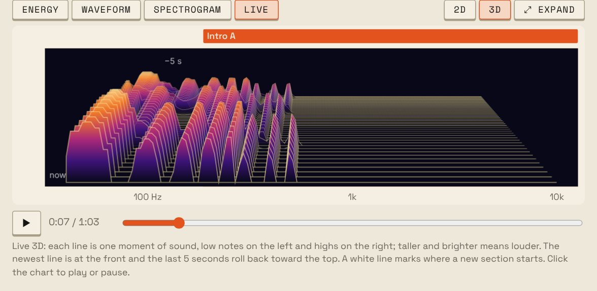

# What Tastr does

Everything a track card shows and what you can do with it. The [README](../README.md) has the short version.

## Track cards

- **Tempo and key.** BPM with how likely it is to be right (calibrated on the benchmarks), a beat and bar grid, and the
  key from a small learned model trained on GiantSteps and Beatport (shown with
  its Camelot code for mixing). Drum & bass is read at its real tempo, not
  half or two thirds of it.
- **Time signature.** Bars of 4 beats (4/4) or 3 (3/4, waltz time), detected
  from how the beats group. Grids, MIDI and Strudel follow it. When it's wrong,
  change it from the track's ⋯ menu; `TASTR_METER=4/4` turns 3/4 detection off.
  6/8 and songs that change meter are read as 4/4 or 3/4.
- **Energy and sections.** An energy curve with rough section boundaries
  (intro, build, drop, chorus, outro...). Sections that sound alike share a
  letter, so `Drop B` and `Outro B` are the same part.
- **Vibe tags.** Scored tags such as bass-heavy, dark or percussive, grouped by
  kind (energy, mood, rhythm, sound...) and tinted by how strongly they apply.
- **File tags.** Title, artist and album from MP3, FLAC and m4a tags.
- **Listed elsewhere (optional).** The BPM and key that [GetSongBPM](https://getsongbpm.com)
  and FreqBlog (your own API keys) or AcousticBrainz's public-domain dump list for the
  track, shown next to Tastr's figures with a mark when they disagree. Off by default; see
  [lookup.md](lookup.md).

## Drums, bass and chords

- **Drum lanes** for kick, snare, clap, hat, open hat, tom and perc, as a
  16-step grid per section (12 steps in 3/4). Template patterns that fit the
  tempo (waltz patterns in 3/4) are one click away. Ask for the optional [drum model](usage.md#drum-model-optional) on a track and kick, hat and tom come from
  [ADTOF](https://github.com/MZehren/ADTOF), a network trained on annotated
  real music that finds toms the built-in detector misses, and a cymbal lane
  (crash and ride) is added.
- **Per-section bass and chords:** the bass note and rhythm for each bar, the
  chord loop with Roman numerals, and what changed from the previous section
  (marked Δ).
- **Edit and play it.** Click steps, pick bass notes and chords, and hear it
  in the browser with a playhead on every part. Solo or mute each drum lane and
  part, drag the BPM box up or down to change the tempo, and export the parts
  you pick as one MIDI file: the section's loop, or the whole track with every
  section in order.
- **Saved edits and versions.** Edits save automatically with the track. Name
  a version to come back to later. Re-analyzing keeps your edits for sections
  that didn't move.

## Try this in Ableton or Strudel

- **Ableton Live:** setup (tempo, scale, Camelot), drum rack programming, bass
  and chord moves, scales to play over each chord, an arrangement map and mix
  notes.
- **[Strudel](https://strudel.cc):** a live-code sketch of the track with each
  section's drums, bass and chords at the right tempo, written the short way live
  coders type it (`bd*4`, `<Am F C G>`), one named line per layer to mute with `_`,
  filter sliders and a punchcard under the code. It can use your edits and the
  original audio cut into bars, either the full mix or separated stems, and start
  from any section. "Open in Strudel" opens it in strudel.cc, ready to play and remix.

## Listen and explore

- **Energy, waveform and spectrogram views** with playback. Click a section to
  play from there, drag the playhead to scrub (you hear it as you drag), and
  scroll to zoom. The spectrogram redraws sharp at your screen's resolution as you zoom.
- **Live tab:** the spectrogram streams with playback, as a scrolling 2D view or a
  3D landscape of ridges. **⤢ Expand** shows any chart bigger, or full screen.
- **Stem separation** into vocals, bass, other and drums with Demucs, on your
  machine or on a [Modal](https://modal.com) GPU (see [Stems](usage.md#stems-optional)).
- **Library sidebar** with search, sort and filters by vibe, key and BPM. Click a
  vibe, the BPM or the key on a track card to filter the list from there (more vibes
  narrow it; the key shows the keys that mix with it).
- **Track and bulk actions:** copy a summary, reload metadata, re-analyze,
  separate stems or delete, for one track or a whole selection.
- **Explore tab:** a BPM-energy chart, and **Find tracks** to search your library
  without code (BPM, key and the keys that mix with it, energy, vibe, length,
  sections, text, with AND/OR groups), or in read-only SQL with a table and column
  reference. Save the searches you use as one-click chips, or start from the
  examples. "Edit as SQL" shows the SQL behind a search.
- **Two looks:** 808 (a drum-machine panel) and Technics (70s hi-fi), picked
  in the header.
- **Keyboard shortcuts** for most things; press `?` for the list.

## Glossary

A built-in reference for every label, number and pattern on a track card,
and how Tastr works each one out. Open it from the **Glossary** tab, or from
"What the vibes mean" under a track's vibes.

- **Camelot wheel:** click a key to see which keys mix with it. Opening the
  Glossary from a track starts on that track's key.
- **Scales you can hear:** pick a key and scale and play it, or click a row
  of the modes table (Dorian, Phrygian...) to hear that mode.
- **Drum styles:** the pattern ideas for each style, drawn from the engine's
  own templates so they always match what the Pattern picker offers.
- **The rules behind the numbers:** vibe scores, section labels, energy and
  how drums, bass and chords are detected, with the actual thresholds.
- **Accuracy that stays current:** the BPM, key and downbeat scores it quotes
  come from the latest full benchmark run (`tastr bench ... --record`), with
  the run date, so they update without touching the page.

