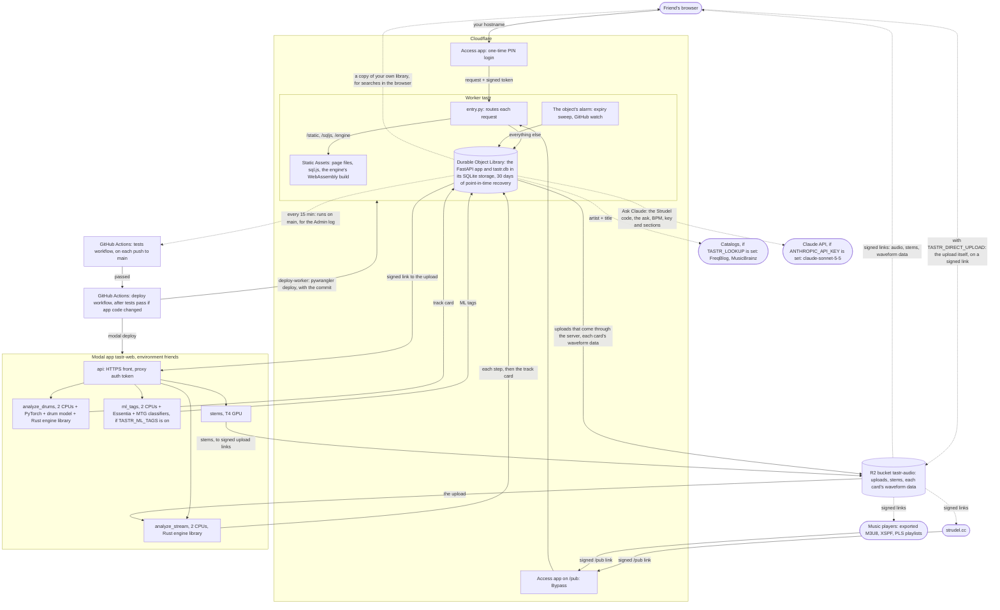
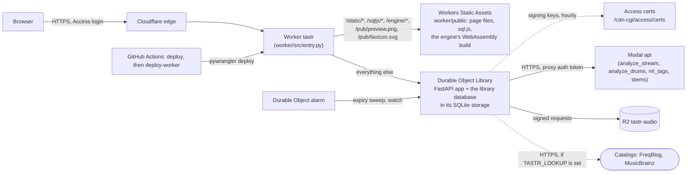

# How hosting fits together

A map of the hosted Tastr: which service does what, what talks to what, how logins are checked and where
each setting lives. [deploy.md](deploy.md) has the setup steps and [hosting.md](hosting.md) what hosted mode
changes in the app.

Six services, each with one job:

| Service | Job |
| --- | --- |
| Cloudflare Workers | Runs the web server: the Worker `tastr` (`worker/`) and its Durable Object `Library`, which holds the library database |
| Cloudflare (DNS and Zero Trust Access) | DNS for your domain, HTTPS at the edge, and the login |
| Cloudflare R2 | Uploads, stems and each card's waveform data (bucket `tastr-audio`) |
| Modal | Analysis, the on-request drum model and stem separation (app `tastr-web`, environment `friends`, `tastr/cloud/modal_web.py`) |
| GitHub Actions | The `deploy` workflow, which ships new code to Modal and the Worker after the tests pass on main (or by hand) |
| Anthropic (Claude API) | "Ask Claude to change it" under Try this in › Strudel, once `ANTHROPIC_API_KEY` is set (`tastr/web/claude.py`) |

Until 2026-11-02 the web server ran on Fly.io, with the database on a volume and Litestream backing it up to R2.
The Worker took over then (TAS-51), and the Fly setup was deleted (TAS-90); [History](#history) has the short
version.

`tests/test_hosting_map.py` fails when a setting, secret or Modal function in the deploy files is missing
from this page. Update the page in the same change.

## The map

Everything a visitor does goes through Cloudflare first, except playing audio: the server answers a request
for a track's audio or a stem with a redirect to a signed link that expires after an hour, and the browser (or
strudel.cc) fetches the bytes from R2 directly. Modal reads uploads from the same kind of link and writes stems
to signed upload links. The server is the only thing that talks to the catalog lookups when they're turned on,
and to the Claude API for "Ask Claude to change it" in Strudel.



Every upload and stem is kept in the audio bucket (`tastr/blobs.py`) under the same path it would have under
`TASTR_HOME` (`uploads/ab12cd34/song.mp3`, `stems/<hash>/drums.flac`), and expiry deletes the bucket's copy.
The Worker's own files are in memory and gone after a restart, so it keeps no local copies. Modal keeps nothing
after a job. With `TASTR_DIRECT_UPLOAD` on, the page uploads each file straight to the bucket on a signed link,
so the file's bytes never pass through the server on the way in (a Worker takes at most 100 MB in one request);
the six-hourly sweep deletes uploads that got a link and were never finished (after two hours), and uploads no
track points at once they're two days old (it deletes nothing if most uploads match no track, which would mean
the paths are off). An upload of bytes the library already has isn't analyzed or kept again; the page can ask
`POST /api/tracks/known` first and skip those files.

## An upload, step by step

```mermaid
sequenceDiagram
  autonumber
  participant B as Browser
  participant C as Cloudflare Access
  participant W as Worker: Durable Object Library
  participant M as Modal: api, then analyze_stream
  participant A as R2 audio bucket
  B->>C: open your hostname
  C-->>B: asks for an email, sends a PIN
  B->>C: PIN
  C->>C: is the email in the Allow policy?
  C->>W: request + Cf-Access-Jwt-Assertion
  W->>W: verify the token, read the email
  Note over W: an idle object wakes here (well under a second)
  B->>B: file size and length within the limits?
  opt TASTR_BROWSER_ENGINE is on
    B->>W: GET /engine/tastr_engine.wasm (once, then cached)
    B->>B: decode and analyze the whole track in a worker (engine.js)
  end
  alt TASTR_DIRECT_UPLOAD is on
    B->>W: POST /api/uploads: name and size
    W->>W: check limits (count, type, size, daily tracks, storage cap)
    W-->>B: a signed upload link (one hour), with an id
    B->>A: PUT the file to the link (3 at a time; a run-out link is renewed once)
    opt the bucket refuses the PUT
      B->>W: POST /api/uploads/{id}/failed (logged for the admin, source r2)
    end
    B->>W: POST /api/uploads/{id}/check
    W->>A: is it there, and how big?
    W->>W: read it back (one upload at a time), check its length from the header, drop the copy
    B->>W: POST /api/analyze/uploaded, on its turn: the id (+ its card)
  else the upload goes through the server
    B->>C: upload a track (+ its card)
    C->>W: upload + token
    W->>W: check limits (size, length from the header)
    W->>A: copy the upload up (refused with 503 if that fails)
  end
  W-->>B: a job id (the upload is done)
  opt the library already has these exact bytes (SHA-256)
    W->>A: delete the new copy (or keep it as the track's audio, if that had expired)
    W-->>B: the existing track, marked already, with nothing analyzed
  end
  opt a card came and checks out
    W->>W: save the card, skip Modal
  end
  W->>M: a signed link to the upload, and options (meter, drum model)
  M->>A: download the upload
  Note over M: cold start about 30 s after a quiet spell
  loop every 1-2 s until done
    M--)W: the step it's on (decode, core, sections...)
    B->>W: GET /api/analyze/jobs/{id}
    W-->>B: the step, for the progress bar
  end
  M-->>W: track card
  W->>W: save the card in tastr.db, owner = the email
  W->>A: the card's waveform data (the card keeps a marker)
  B->>W: GET /api/analyze/jobs/{id}
  W-->>B: done, with the track id
  B->>W: GET /api/tracks/{id}/audio (playback)
  W-->>B: 302 to a signed link (one hour)
  B->>A: GET the audio, with Range for seeking
```

Modal analyzes with the Rust engine (`tastr/cloud/rust_image.py` builds its library into the image); Python only
decodes the formats Rust can't (Opus) and runs the optional drum model.

With `TASTR_BROWSER_ENGINE` on, the page loads the Rust engine's WebAssembly build from the server
(`/engine/tastr_engine.wasm`, about 2 MB, cached by its hash), makes the whole card in a worker and uploads it
with the audio. The server stores that card without calling Modal when it checks out: made by the build the
server serves now, every stage at the engine's versions, as long as the file (`tastr/engine/browser_card.py`).
Otherwise, and for Opus files, tracks over 20 minutes or any failure in the browser, Modal analyzes the file as
usual. Both run the same Rust engine, so a card is the same wherever it was made. Off by default; see
[rust-engine.md](rust-engine.md).

The job's state is also kept in the database (`job_markers`, `tastr/markers.py`), so if the object restarts
mid-analysis, the page hears that it failed and can upload again.

Stems work the same way through Modal's `stems` function, which uploads each stem to a signed link of its own,
so stems never pass through the server. "Detect drums with the model" in a track's menu re-analyzes it through
`analyze_drums`, which is `analyze` plus PyTorch and the pretrained drum model's weights, kept in its own image
so everyday uploads don't wait for PyTorch to load. A queued or running separation or drum model run leaves a
marker in the database (`job_markers`), so it resumes after a restart. ML tags (with `TASTR_ML_TAGS=auto`, after
each new upload is analyzed, and once for every track from before) send the track's audio link to `ml_tags`, which runs MTG's Essentia classifiers and returns
the tags. They queue one at a time and leave markers too. The server keeps them in the `ml_tags` table, apart from the card, so re-analysis keeps them.

## Which service handles which step

| Step | Service | Detail |
| --- | --- | --- |
| Name to address | Cloudflare | The Worker's custom domain (**Workers > tastr > Settings > Domains & Routes**) creates the DNS record and the certificate. The registrar only points the domain's nameservers at Cloudflare. |
| Login | Cloudflare Access | Emails a one-time PIN, checks the Allow policy, adds a signed token to each request. |
| Checking the login | The Worker | `AccessVerifier` in `tastr/web/hosted.py` checks the token on every request and takes the email from it. The Worker fetches Access's signing keys itself (`AccessKeys`), since PyJWT's own client can't open sockets there. |
| Routing | The Worker | `worker/src/entry.py` sends `/static/*`, `/sqljs/*` and `/engine/*` to Static Assets and everything else to the Durable Object. |
| UI, API, per-person libraries, limits | The Durable Object `Library` | The same FastAPI app as `tastr serve`, in hosted mode (`TASTR_HOSTED`), on one event loop (`create_app(threads=False)`). |
| Database | The Durable Object's SQLite storage | `tastr/do_sqlite.py` (`db.use_storage`). Cloudflare keeps 30 days of point-in-time recovery. |
| Searches (Simple and SQL) | The visitor's browser | `GET /api/query/library` sends a SQLite copy of the person's own library (admins: every library), once per page; sql.js (MIT, a static asset under `/sqljs/`) runs each search in a worker (`static/sql-worker.js`, `app/query-lib.js`). The server has no SQL endpoint in hosted mode. |
| Audio and stems | R2 bucket `tastr-audio` | With `TASTR_AUDIO_BUCKET`, `TASTR_AUDIO_ENDPOINT` and the bucket's own token (`TASTR_AUDIO_ACCESS_KEY_ID`, `TASTR_AUDIO_SECRET_ACCESS_KEY`), `tastr/blobs.py` keeps each upload and stem there and plays them from signed links (`TASTR_AUDIO_REGION` defaults to `auto`); the page's Content-Security-Policy allows that host. `tastr/s3.py` signs each request itself (no boto3) and `tastr/http.py` sends it with the Worker's fetch. The bucket's CORS rule lets any origin GET, since strudel.cc follows the redirect, and (for `TASTR_DIRECT_UPLOAD`) lets your hostname PUT. Each card's waveform and spectrogram data goes there too (`views/<track id>.json`, gzipped), so the database keeps a marker instead of about a megabyte per card; `/api/tracks/{id}/views` redirects to it. |
| Whole analysis (optional) | The visitor's browser | With `TASTR_BROWSER_ENGINE` on, `tastr/web/static/engine.js` runs the Rust engine's WebAssembly build in a worker and the upload carries the card. `deploy-worker.yml` builds the `.wasm` and `worker/build.py` puts it with the static assets. |
| Analysis | Modal `analyze_stream` (or `analyze`) | Picked by `TASTR_ANALYSIS_BACKEND`, found by `TASTR_MODAL_APP` and `MODAL_ENVIRONMENT`. Yields each step as it starts, then the card. Stays warm 1 minute after a request. Cards always come from the Rust engine, whose library the image builds (`tastr/cloud/rust_image.py`). |
| Drum model (on request) | Modal `analyze_drums` | Used for the tracks someone asks for, through the same `TASTR_ANALYSIS_BACKEND`. CPU-only PyTorch; the weights (CC BY-NC-SA 4.0) are downloaded into the image at deploy time. The model runs in Python and the Rust library, built into this image too, makes the card. |
| ML tags (optional) | Modal `ml_tags` | With the Worker's `TASTR_ML_TAGS` set to `auto`, as it is in `worker/wrangler.jsonc`, every new upload gets them after its analysis, and the tracks from before got them once (`on`: only on request) (MTG's weights are non-commercial only, docs/essentia.md). Essentia (AGPL-3.0) and the weights are installed into its own image at deploy time; no Rust engine. One track at a time, about 6 s of embedding for a 5-minute track; about $1 of Modal time per 1,000 tracks. |
| Stems | Modal `stems` | Picked by `TASTR_STEMS_BACKEND`. Demucs on a T4 GPU. Reads the upload from a signed link and uploads each stem to a signed link of its own. |
| The way in to Modal | Modal `api` | A small web endpoint in front of the functions above, since the Worker can't run the Modal client. Only callers with a Modal proxy auth token get in. Every answer streams lines of JSON, with a blank line every 20 seconds so a long call stays open. The Worker calls it at `TASTR_MODAL_URL`, with the token as `TASTR_MODAL_KEY` and `TASTR_MODAL_SECRET` (`tastr/cloud/remote.py`). |
| Background work | The Durable Object | `tastr/runner.py`: jobs (analyses, stems, drum model runs, ML tags) are asyncio tasks in lanes that queue them, and the repeating work (the expiry sweep every 6 hours, the GitHub watch) runs from the object's alarm, which wakes it when it is due. |
| Shipping code | GitHub Actions | `.github/workflows/deploy.yml`: Modal first, then the Worker (`deploy-worker.yml`), from main. Runs after `tests` passes on a push to main when something that ships changed since the last deploy, or by hand. |

## How security works

Four layers, each assuming the one before it might be bypassed.

1. **Cloudflare Access at the door.** Only emails in the Allow policy get a PIN. Deleting an address
   locks that person out at their next sign-in.
2. **Tastr checks Cloudflare's signature.** The Worker has no `*.workers.dev` or preview address
   (`workers_dev` and `preview_urls` are off in `worker/wrangler.jsonc`), so the custom domain behind Access is
   the only way in. Even so, the server trusts only a token signed by your team (`TASTR_ACCESS_TEAM_DOMAIN`) for
   this application (`TASTR_ACCESS_AUD`). No valid token means 401, except `/api/health`, signed `/pub/`
   links and short `/pub/s/` share links. Without both settings the server won't start.
3. **Per-person libraries and limits.** Each track belongs to the email that uploaded it; anyone else gets
   404. Uploads (size and length), stems, drum model runs, Claude asks, storage and concurrent analyses are
   capped; link downloads and API docs are off; searches run in the browser on a copy of the person's own
   library (admins: every library), with no owner or path columns, so the server runs no one's SQL; errors
   don't name server paths; responses carry CSP (`'wasm-unsafe-eval'` lets workers compile WebAssembly,
   nothing else) and HSTS headers.
4. **Signed Strudel and playlist links.** strudel.cc can't sign in, and neither can a music player opening a
   playlist exported from Library › List (`/api/lists/{id}/playlist.m3u8`, `.xspf`, `.pls`), so the `/pub`
   Bypass application lets them through Cloudflare. Tastr checks each link itself: an HMAC with
   `TASTR_LINK_SECRET` over one track id and an expiry 7 days out. Changing the secret ends every outstanding
   link. The playlist zip (`playlist.zip`) holds the audio itself, so it needs no link.
   Short Strudel share links (`/pub/s/<id>`, TAS-100) go through the same Bypass. Each is a random 10-character
   id for code someone saved with `POST /api/strudel/share` (after signing in), kept in the `strudel_shares`
   table. Opening one serves a small page that sends the browser on to strudel.cc with the code, after signing
   the code's `/pub/` audio and stem links again, only for tracks the person who made it still has.
   The page carries OpenGraph and Twitter tags, so chat apps show a preview card; their crawlers can't sign in,
   so its image and icon are public too: `/pub/preview.png` and `/pub/favicon.svg`, which the Worker serves from
   Static Assets (`PUBLIC_ASSETS` in `worker/src/entry.py`). Any other link shows the Access login in a preview.

Keys are split so a leak stays small. The audio bucket's R2 token is scoped to `tastr-audio`, not the benchmark
bucket `tastr-data`. The Worker reaches Modal with a proxy auth token that can only call the `api` endpoint, and
GitHub deploys with its own Modal token, so either can be revoked alone. The `friends` Modal environment keeps
the app's spending apart from benchmarks.

## Where each setting lives

### In the repository

| File | What it sets |
| --- | --- |
| `worker/wrangler.jsonc` | The Worker's name (`tastr`), the Durable Object `Library` and its SQLite migration, Static Assets, Observability (on), the CPU limit per request (5 minutes), no `workers.dev` or preview addresses, and the plain settings (`vars`) below |
| `worker/src/entry.py`, `worker/build.py`, `worker/check.sh` | The Worker's entry point, the bundle of static files, and the build check CI runs |
| `tastr/cloud/modal_web.py` | Modal functions `analyze`, `analyze_stream`, `analyze_drums`, `ml_tags`, `stems` and `api`, their images, CPU, GPU, memory and timeouts |
| `.github/workflows/deploy.yml`, `.github/workflows/deploy-worker.yml` | When it deploys (after `tests` on main, which files count), the deploy order (Modal, then the Worker), which repository secrets it uses (`MODAL_TOKEN_ID`, `MODAL_TOKEN_SECRET`, `CLOUDFLARE_API_TOKEN`), and the commit it sets as the Worker's `TASTR_COMMIT`, `TASTR_COMMIT_SUBJECT` and `TASTR_DEPLOY_RUN` |

### Worker settings (`vars` in `worker/wrangler.jsonc`)

A deploy resets these to what's in the file, so change them there, not in the dashboard.

| Setting | Value | Used for |
| --- | --- | --- |
| `TASTR_HOSTED` | `1` | Hosted mode ([hosting.md](hosting.md)) |
| `TASTR_ANALYSIS_BACKEND`, `TASTR_STEMS_BACKEND` | `modal` | Analysis and stems on Modal |
| `TASTR_MODAL_APP`, `MODAL_ENVIRONMENT` | `tastr-web`, `friends` | Which Modal app, and the Admin tab's Modal link |
| `TASTR_WORKER_NAME` | `tastr` | The Admin tab's Worker logs link, and the source of its deploy and restart lines |
| `TASTR_CF_ACCOUNT_ID` | the account id (not a secret) | The Admin tab's links to the Worker's logs, Access's applications and its log of blocked requests |
| `TASTR_GITHUB_REPO`, `TASTR_GITHUB_WORKFLOWS` | `pocketIlmatto/tastr`, `tests,deploy` | Whose GitHub Actions runs the Admin log shows, and which workflows |
| `TASTR_ML_TAGS` | `auto` | ML tags on every new upload, and once on the tracks from before (`on`: only on request), run on Modal's `ml_tags`. MTG's weights are licensed for non-commercial use only ([essentia.md](essentia.md)); remove it to switch them off |

### Worker secrets

Set with `pywrangler secret put NAME` in `worker/`, or in the dashboard under **Workers > tastr > Settings >
Variables and Secrets** as type **Secret** (a plain Text variable added there is wiped by the next deploy).

| Secret | Used for |
| --- | --- |
| `TASTR_ACCESS_TEAM_DOMAIN`, `TASTR_ACCESS_AUD` | Checking Cloudflare's token. Not secret, but kept out of the repository. |
| `TASTR_ADMIN_EMAILS` | Who gets the Admin tab and keeps audio forever |
| `TASTR_LINK_SECRET` | Signing Strudel and playlist links |
| `TASTR_STORAGE_GB` | A cap on the uploads and stems the bucket holds |
| `TASTR_AUDIO_BUCKET`, `TASTR_AUDIO_ENDPOINT`, `TASTR_AUDIO_ACCESS_KEY_ID`, `TASTR_AUDIO_SECRET_ACCESS_KEY` | The audio bucket `tastr-audio` and its own token ([deploy.md](deploy.md#2-r2-bucket-for-audio)). Required on the Worker. |
| `TASTR_MODAL_URL`, `TASTR_MODAL_KEY`, `TASTR_MODAL_SECRET` | The Modal `api` endpoint's address (`modal deploy` prints it) and a Modal proxy auth token |
| `TASTR_GITHUB_TOKEN` (optional) | Reading GitHub Actions runs for the Admin log: a fine-grained token with read-only Actions access to the repository. Needed even for a public repository: GitHub's limit without a token is per IP address, which Cloudflare shares, so most checks get 403. |
| `TASTR_LOOKUP`, `FREQBLOG_API_KEY` (optional) | Catalog lookups ([lookup.md](lookup.md), [deploy.md](deploy.md#8-catalog-lookups-optional)). Not `acousticbrainz`, whose index file the Worker can't hold (TAS-88). |
| `ANTHROPIC_API_KEY` (optional) | "Ask Claude to change it" in Try this in › Strudel ([deploy.md](deploy.md#9-ask-claude-in-strudel-optional)). Tastr's own Anthropic key; each ask's tokens are counted per person and priced on the Admin tab. Without it the panel says Ask is off. |

These have defaults and change only if you set a secret of the same name ([hosting.md](hosting.md#settings)):
`TASTR_MAX_UPLOAD_MB`, `TASTR_MAX_MINUTES`, `TASTR_MAX_FILES`, `TASTR_DAILY_TRACKS`, `TASTR_MAX_ANALYSES`,
`TASTR_BULK_AT_ONCE` (tracks a bulk action runs at once; defaults to `TASTR_MAX_ANALYSES`), `TASTR_DAILY_STEMS`,
`TASTR_DAILY_DRUMS`, `TASTR_DAILY_ASKS` (Claude asks per person per day, default 20), `TASTR_AUDIO_DAYS`,
`TASTR_MODAL_WORKSPACE` (your Modal workspace name, so the Admin tab's Modal link opens the app) and
`TASTR_WATCH_MINUTES` (default 15: how often the server checks GitHub Actions for the Admin log; `0` turns it
off). `TASTR_BROWSER_ENGINE=1` (off by default) has the browser make the whole card with the Rust engine.
`TASTR_DIRECT_UPLOAD=1` (off by default; needs the bucket's PUT rule) has the page upload straight to the
bucket. `deploy-worker.yml` passes `TASTR_COMMIT`, `TASTR_COMMIT_SUBJECT` and `TASTR_DEPLOY_RUN` on each deploy, so
the Admin tab's deploy line names the commit and links to its GitHub Actions run. Not `TASTR_HOME` (the Worker's is `/tmp/tastr`, in memory).

### Dashboards

| Setting | Where |
| --- | --- |
| The hostname | Cloudflare **Workers & Pages > tastr > Settings > Domains & Routes** |
| Logs and errors | **Workers & Pages > tastr > Observability** (linked from the Admin tab), or `npx wrangler tail tastr` |
| The database's point-in-time recovery | The Durable Object API (`ctx.storage.getBookmarkForTime`, `onNextSessionRestoreBookmark`); see Cloudflare's Durable Objects docs |
| Who's invited | Cloudflare **Zero Trust > Access > Applications** > the Tastr application > its Allow policy (the Admin tab links here) |
| Who was blocked, and why | **Zero Trust > Logs > Access** (linked from the Admin tab's blocked count) |
| Login method | **Zero Trust > Settings > Authentication** (One-time PIN) |
| AUD tag | The Tastr Access application's **Overview** |
| `/pub` bypass | A second Access application, same hostname, path `pub`, Bypass policy |
| Health check's service token | **Zero Trust > Access > Service credentials > Service Tokens**; the Tastr application has a Service Auth policy for it. GitHub secrets `CF_ACCESS_CLIENT_ID`, `CF_ACCESS_CLIENT_SECRET` (`.github/workflows/health.yml`, docs/ci.md) |
| Audio bucket, its CORS rule and token | Cloudflare **R2 Object Storage** > `tastr-audio` > **Settings** > CORS Policy; **Manage API tokens** |
| Workers plan | **Workers & Pages > Plans**: Workers Paid ($5 a month), since the bundle (about 7.7 MiB gzipped) is over the Free plan's 3 MiB |
| Modal usage and spend cap | Modal dashboard, environment `friends`; **Settings > Usage** |
| Modal tokens | Modal **Settings > Proxy Auth Tokens** (the Worker's) and **Settings > API Tokens** (GitHub's) |
| Anthropic key and spend limit | Anthropic Console **Settings > API Keys** and **Limits** (set a monthly spend limit for the key's workspace) |
| Deploy secrets | GitHub **Settings > Secrets and variables > Actions**: `CLOUDFLARE_API_TOKEN`, `MODAL_TOKEN_ID`, `MODAL_TOKEN_SECRET` |

## The Worker, inside



- Everything that leaves the object (Modal, R2, Access's keys, GitHub, the catalogs, the Claude API) goes
  through `tastr/http.py`, which uses the Worker's fetch, since a Python Worker can't open sockets.
  The catalog lookups' per-provider guard waits with the runner's `sleep`, which lets other requests run,
  instead of holding the event loop.
- Its memory (128 MB for the Durable Object) is why it keeps no local copies (`blobs.keep_copies`): a checked
  upload's copy is dropped until its analysis reads it back, only one request or job holds a copy at a time
  (`blobs.copy_limit`), the analysis drops it again once it has the tags and the hash, before Modal reads the
  bucket's copy, and zips stream from the bucket. A restart that
  hits the limit rolls back a transaction that wasn't committed.
- A card's waveform data goes to the bucket after the card's transaction, never inside it (`transactionSync` is
  a synchronous call, so a fetch can't wait in it); the six-hourly sweep moves any that a card had to keep.
- Browser files: `worker/build.py` puts the page's files, sql.js (for the Simple and SQL searches; pinned in
  `worker/package.json` at the version `routes/search.py` names) and the Rust engine's WebAssembly build (for
  `TASTR_BROWSER_ENGINE`; `deploy-worker.yml` builds it, and `src/tastr_build.py` records its hash for the
  card check) in `worker/public/`, and Static Assets serve them.
- CI builds the Worker whenever the app or `worker/` changes (`worker/check.sh`, the last steps of
  `.github/workflows/test.yml`): it bundles it with its Pyodide packages, fails above 10 MiB gzipped (the Workers
  Paid limit; it is about 7.7 MiB), and runs it under `pywrangler dev` to check a few pages answer.
- The Admin tab: the version that last started is kept in the database (`meta`), so a new `TASTR_COMMIT` logs a
  "Deployed ..." line (with `TASTR_COMMIT_SUBJECT` and the run, `TASTR_DEPLOY_RUN`). `TASTR_WORKER_NAME` and
  `TASTR_CF_ACCOUNT_ID` give it a link to the Worker's logs, and `TASTR_GITHUB_REPO` with
  `TASTR_GITHUB_WORKFLOWS` its GitHub Actions lines.
- `tastr pack`, `tastr unpack`, `tastr bucket-backfill` and the other commands that work on a server's files need
  a shell, which the Worker doesn't have. They still work for a hosted `tastr serve` on a machine of your own.

## Common tasks

| To | Do this |
| --- | --- |
| Invite someone | Add their email to the Access Allow policy. Nothing on the Worker changes. |
| Remove someone | Delete their email from the policy. Their tracks stay until you delete them. |
| Ship new code | Merge to main. Once `tests` passes, `deploy` runs on its own and deploys Modal, then the Worker (skipped when the merge only touched docs, tests or Markdown). To deploy anyway: **Actions > deploy > Run workflow**; just the Worker: **Actions > deploy-worker > Run workflow**. |
| See usage | The Admin tab (today by hour, 7 or 30 days, or all time); Modal's usage page for actual cost. |
| Let someone upload more today | Admin tab > ✎ on their row > Today only. The same row raises their Claude asks. |
| Read the server's logs | Admin tab > Worker logs, or `npx wrangler tail tastr` for a live stream. |
| Undo a bad change to the library | Restore the Durable Object to a point in the last 30 days (see Dashboards). Audio and stems are in the bucket and aren't affected. |
| Rotate a key | Make a new one at its source, `pywrangler secret put` it (or update the GitHub secret), then revoke the old one. [settings.md](settings.md) lists every secret and when each expires. |

## Why it's sometimes slow

An idle Durable Object wakes quickly, so the page itself opens fast. Modal stops its container 1 minute after
the last analysis, so the first upload after a quiet spell waits about 30 seconds for a new one. A drum model
run usually starts its own, larger container, so it takes a minute or two.

## History

Tastr was first hosted on Fly.io: one 512 MB machine (app `tastr-frienz`) with the database, uploads and stems on
a volume, Litestream copying every database change to the R2 bucket `tastr-app`, and the server talking to Modal
through the Modal client. The Fly exit plan (TAS-84) moved it to the Worker. On 2026-11-02 the library was copied
across once and the hostname pointed at the Worker (TAS-51); the Fly app, its image, its config and the one-time
import code were removed afterwards (TAS-90).
