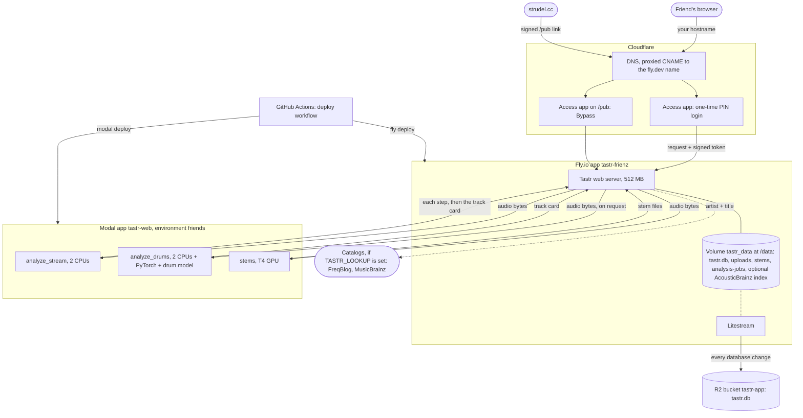
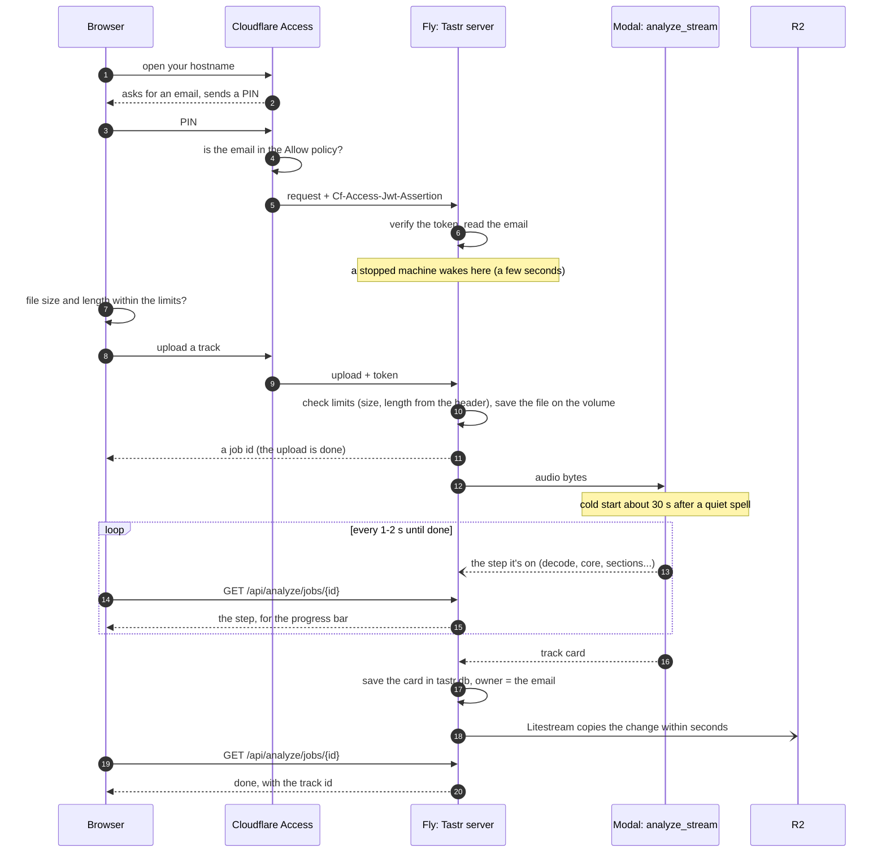

# How hosting fits together

A map of the hosted Tastr: which service does what, what talks to what, how logins are checked and where
each setting lives. [deploy.md](deploy.md) has the setup steps and [hosting.md](hosting.md) what hosted mode
changes in the app.

Five services, each with one job:

| Service | Job |
| --- | --- |
| Cloudflare | DNS for your domain, HTTPS at the edge, and the login (Zero Trust Access) |
| Fly.io | Runs the web server (app `tastr-frienz` in `fly.toml`) and keeps the database, uploads and stems on its volume |
| Modal | Analysis, the on-request drum model and stem separation (app `tastr-web`, environment `friends`, `tastr/cloud/modal_web.py`) |
| Cloudflare R2 | Litestream's backup of the library database (bucket `tastr-app`) |
| GitHub Actions | The manual `deploy` workflow, which ships new code to Modal and Fly |

`tests/test_hosting_map.py` fails when a setting, secret or Modal function in the deploy files is missing
from this page. Update the page in the same change.

## The map

Everything a visitor does goes through Cloudflare first. The Fly server is the only thing that talks to Modal
and R2, and to the catalog lookups when they're turned on.

Audio has no storage of its own: uploads and stems live only on the Fly volume and expire after
`TASTR_AUDIO_DAYS`. R2 backs up the database (cards, edits, who owns what), not the audio. Modal keeps
nothing after a job.

## An upload, step by step

The job's state is a small file under `analysis-jobs/` on the volume too, so if the machine stops mid-analysis,
the page hears that it failed and can upload again. An app deployed before `analyze_stream` existed still
works: the server falls back to Modal's `analyze`, without steps.

Stems work the same way through Modal's `stems` function; the server saves the files it gets back on the
volume. "Detect drums with the model" in a track's menu re-analyzes it through `analyze_drums`, which is
`analyze` plus PyTorch and the pretrained drum model's weights, kept in its own image so everyday uploads
don't wait for PyTorch to load. A queued or running separation or drum model run leaves a marker on the
volume (`stems/*.job`, `drum-jobs/*.job`), so it resumes if the machine stops and starts again.

## Which service handles which step

| Step | Service | Detail |
| --- | --- | --- |
| Name to address | Cloudflare DNS | A proxied CNAME for your hostname points at `<app>.fly.dev`. The registrar only points the domain's nameservers at Cloudflare. |
| HTTPS | Cloudflare and Fly | Cloudflare's certificate faces browsers; Fly's (`fly certs add`, checked with the `_acme-challenge` record) covers the Cloudflare-to-Fly hop, hence SSL/TLS **Full (strict)**. |
| Login | Cloudflare Access | Emails a one-time PIN, checks the Allow policy, adds a signed token to each request. |
| Checking the login | Tastr on Fly | `AccessVerifier` in `tastr/web/hosted.py` checks the token on every request and takes the email from it. |
| UI, API, per-person libraries, limits | Tastr on Fly | `tastr serve` in hosted mode (`TASTR_HOSTED`). |
| Files | Fly volume `tastr_data` | Mounted at `/data` (`TASTR_HOME`): `tastr.db`, `uploads/`, `stems/`, and the optional AcousticBrainz lookup index `acousticbrainz-index.sqlite` (not backed up). |
| Analysis | Modal `analyze_stream` (or `analyze`) | Picked by `TASTR_ANALYSIS_BACKEND`, found by `TASTR_MODAL_APP` and `MODAL_ENVIRONMENT`. Yields each step as it starts, then the card. Stays warm 1 minute after a request. |
| Drum model (on request) | Modal `analyze_drums` | Used for the tracks someone asks for, through the same `TASTR_ANALYSIS_BACKEND`. CPU-only PyTorch; the weights (CC BY-NC-SA 4.0) are downloaded into the image at deploy time. |
| Stems | Modal `stems` | Picked by `TASTR_STEMS_BACKEND`. Demucs on a T4 GPU. |
| Database backup | Litestream to R2 | `deploy/start.sh` restores onto an empty volume, then runs the server under `litestream replicate` (`deploy/litestream.yml`). |
| Shipping code | GitHub Actions | `.github/workflows/deploy.yml`: Modal first, then Fly, from main. |

## How security works

Four layers, each assuming the one before it might be bypassed.

1. **Cloudflare Access at the door.** Only emails in the Allow policy get a PIN. Deleting an address
   locks that person out at their next sign-in.
2. **Tastr checks Cloudflare's signature.** `<app>.fly.dev` skips Cloudflare, so the server trusts only a
   token signed by your team (`TASTR_ACCESS_TEAM_DOMAIN`) for this application (`TASTR_ACCESS_AUD`). No valid
   token means 401, except `/api/health` and signed `/pub/` links. Without both settings the server won't
   start.
3. **Per-person libraries and limits.** Each track belongs to the email that uploaded it; anyone else gets
   404. Uploads (size and length), stems, drum model runs, storage and concurrent analyses are capped; link downloads and API docs are off; the SQL box
   reads a copy of the person's own library (admins: the whole database), only SELECTs, for at most 2 s; errors don't name server paths; responses carry CSP and HSTS headers.
4. **Signed Strudel links.** strudel.cc can't sign in, so the `/pub` Bypass application lets it through
   Cloudflare. Tastr checks each link itself: an HMAC with `TASTR_LINK_SECRET` over one track id and an expiry
   7 days out. Changing the secret ends every outstanding link.

Keys are split so a leak stays small. The R2 token is scoped to `tastr-app`, not the benchmark bucket
`tastr-data`. Fly and GitHub each use their own Modal token, so either can be revoked alone. The `friends`
Modal environment keeps the app's spending apart from benchmarks.

## Where each setting lives

### In the repository

| File | What it sets |
| --- | --- |
| `fly.toml` | App name (`tastr-frienz`), region (`sjc`), the volume (`tastr_data` at `/data`), auto-stop, the `/api/health` check, a 512 MB VM, and the non-secret environment: `TASTR_HOSTED`, `TASTR_HOME`, `TASTR_ANALYSIS_BACKEND`, `TASTR_STEMS_BACKEND`, `TASTR_MODAL_APP`, `MODAL_ENVIRONMENT` |
| `Dockerfile`, `deploy/start.sh`, `deploy/litestream.yml` | The server image, the restore-then-replicate start, and the backup target |
| `tastr/cloud/modal_web.py` | Modal functions `analyze`, `analyze_stream`, `analyze_drums` and `stems`, their images, CPU, GPU, memory and timeouts |
| `.github/workflows/deploy.yml` | The deploy order and which repository secrets it uses |

### Fly secrets

Set with `fly secrets set` (each change restarts the app); `fly secrets list` shows names only.

| Secret | Used for |
| --- | --- |
| `TASTR_ACCESS_TEAM_DOMAIN`, `TASTR_ACCESS_AUD` | Checking Cloudflare's token. Not secret, but kept out of the repository. |
| `TASTR_ADMIN_EMAILS` | Who gets the Admin tab and keeps audio forever |
| `TASTR_LINK_SECRET` | Signing Strudel links |
| `TASTR_STORAGE_GB` | The upload cap, kept below the volume size |
| `MODAL_TOKEN_ID`, `MODAL_TOKEN_SECRET` | The server's Modal token |
| `LITESTREAM_BUCKET`, `LITESTREAM_ENDPOINT`, `LITESTREAM_ACCESS_KEY_ID`, `LITESTREAM_SECRET_ACCESS_KEY` | The R2 backup |
| `TASTR_LOOKUP`, `FREQBLOG_API_KEY` (optional) | Catalog lookups ([lookup.md](lookup.md), [deploy.md](deploy.md#9b-catalog-lookups-optional)) |

These have defaults and change only if you set a Fly secret of the same name ([hosting.md](hosting.md#settings)):
`TASTR_MAX_UPLOAD_MB`, `TASTR_MAX_MINUTES`, `TASTR_MAX_FILES`, `TASTR_DAILY_TRACKS`, `TASTR_MAX_ANALYSES`, `TASTR_DAILY_STEMS`,
`TASTR_DAILY_DRUMS`, `TASTR_AUDIO_DAYS`.

### Dashboards

| Setting | Where |
| --- | --- |
| DNS records, SSL/TLS mode | Cloudflare > your domain > **DNS** and **SSL/TLS** |
| Who's invited | Cloudflare **Zero Trust > Access > Applications** > the Tastr application > its Allow policy |
| Login method | **Zero Trust > Settings > Authentication** (One-time PIN) |
| AUD tag | The Tastr Access application's **Overview** |
| `/pub` bypass | A second Access application, same hostname, path `pub`, Bypass policy |
| Backup bucket and its token | Cloudflare **R2 Object Storage** > `tastr-app`; **Manage API tokens** |
| Volume, logs, certificates | Fly dashboard, or `fly volumes list`, `fly logs`, `fly certs show <hostname>` |
| Modal usage and spend cap | Modal dashboard, environment `friends`; **Settings > Usage** |
| Modal tokens | Modal **Settings > API Tokens** (one for Fly, one for GitHub) |
| Deploy secrets | GitHub **Settings > Secrets and variables > Actions**: `FLY_API_TOKEN`, `MODAL_TOKEN_ID`, `MODAL_TOKEN_SECRET` |

## Common tasks

| To | Do this |
| --- | --- |
| Invite someone | Add their email to the Access Allow policy. Nothing on Fly changes. |
| Remove someone | Delete their email from the policy. Their tracks stay until you delete them. |
| Ship new code | Merge to main, then **Actions > deploy > Run workflow**. |
| See usage | The Admin tab; Modal's usage page for cost. |
| Recover a lost volume | Create a volume named `tastr_data` and deploy. The database comes back from R2; audio and stems don't. |
| Rotate a key | Make a new one at its source, `fly secrets set` it (or update the GitHub secret), then revoke the old one. |

## Why it's sometimes slow

To stay cheap, the Fly machine stops after a few idle minutes and the next request wakes it (a few seconds).
Modal stops its container 1 minute after the last analysis, so the first upload after a quiet spell waits
about 30 seconds more. A drum model run usually starts its own, larger container, so it takes a minute
or two.
