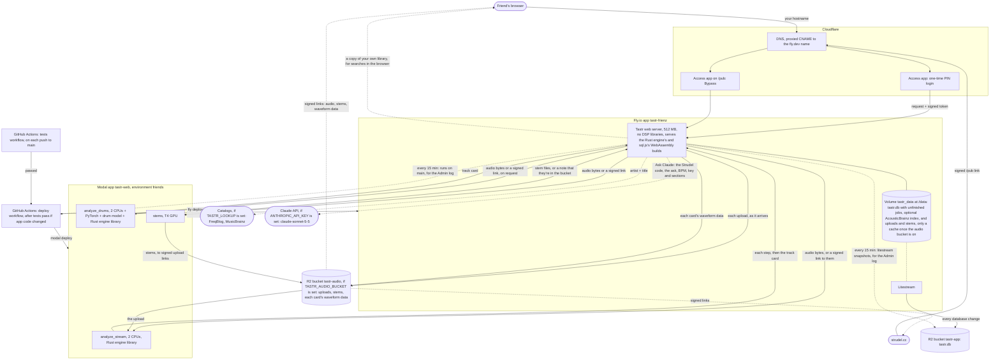
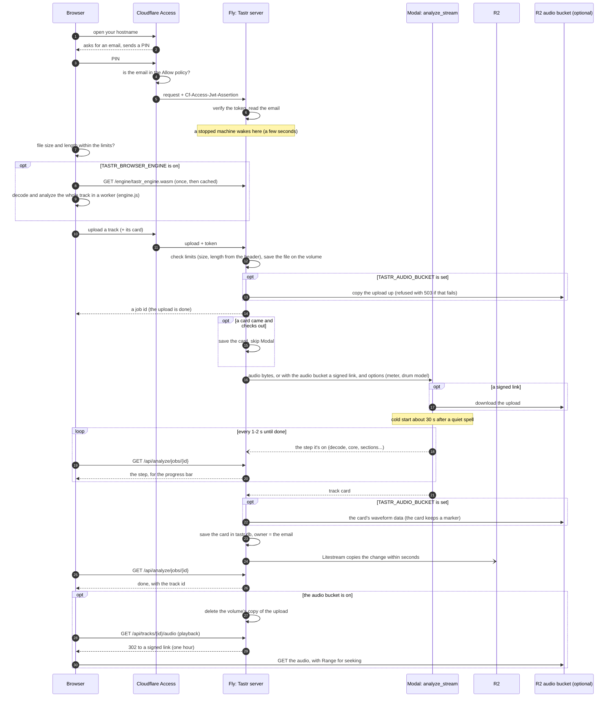

# How hosting fits together

A map of the hosted Tastr: which service does what, what talks to what, how logins are checked and where
each setting lives. [deploy.md](deploy.md) has the setup steps and [hosting.md](hosting.md) what hosted mode
changes in the app.

Six services, each with one job:

| Service | Job |
| --- | --- |
| Cloudflare | DNS for your domain, HTTPS at the edge, and the login (Zero Trust Access) |
| Fly.io | Runs the web server (app `tastr-frienz` in `fly.toml`) and keeps the database on its volume, with uploads and stems too unless the audio bucket is on |
| Modal | Analysis, the on-request drum model and stem separation (app `tastr-web`, environment `friends`, `tastr/cloud/modal_web.py`) |
| Cloudflare R2 | Litestream's backup of the library database (bucket `tastr-app`) and, once `TASTR_AUDIO_BUCKET` is set, the uploads and stems (bucket `tastr-audio`) |
| GitHub Actions | The `deploy` workflow, which ships new code to Modal and Fly after the tests pass on main (or by hand) |
| Anthropic (Claude API) | "Ask Claude to change it" under Try this in › Strudel, once `ANTHROPIC_API_KEY` is set (`tastr/web/claude.py`) |

`tests/test_hosting_map.py` fails when a setting, secret or Modal function in the deploy files is missing
from this page. Update the page in the same change.

## The map

Everything a visitor does goes through Cloudflare first, except playing audio from the audio bucket: with
`TASTR_AUDIO_BUCKET` set, the server answers a request for a track's audio or a stem with a redirect to a
signed link that expires after an hour, and the browser (or strudel.cc) fetches the bytes from R2 directly.
Modal reads uploads from the same kind of link and writes stems to signed upload links. Without the setting,
audio stays on the Fly volume and passes through the server as before. The server is the only thing that talks
to the catalog lookups when they're turned on, and to the Claude API for "Ask Claude to change it" in Strudel.

Without the audio bucket, uploads and stems live only on the Fly volume and expire after `TASTR_AUDIO_DAYS`,
and R2 backs up only the database (cards, edits, who owns what). With `TASTR_AUDIO_BUCKET` set
(`tastr/blobs.py`), every upload and stem is kept in that bucket under the same path it has under `/data`
(`uploads/ab12cd34/song.mp3`, `stems/<hash>/drums.flac`), the volume holds only copies that the six-hourly sweep
deletes once they're an hour old, and expiry deletes the bucket's copy. Modal keeps nothing after a job.

## An upload, step by step

Modal analyzes with the Rust engine (`tastr/cloud/rust_image.py` builds its library into the image); Python only
decodes the formats Rust can't (Opus) and runs the optional drum model.

With `TASTR_BROWSER_ENGINE` on, the page the Rust engine's WebAssembly build from the
server (`/engine/tastr_engine.wasm`, about 2 MB, cached by its hash), makes the whole card in a worker and uploads
it with the audio. The server stores that card without calling Modal when it checks out: made by the build the
server serves now, every stage at the engine's versions, as long as the file (`tastr/engine/browser_card.py`).
Otherwise, and for Opus files, tracks over 20 minutes or any failure in the browser, Modal analyzes the file as
usual. Both run the same Rust engine, so a card is the same wherever it was made. Off by default; see
[rust-engine.md](rust-engine.md).

The job's state is also kept in the database (`job_markers`, `tastr/markers.py`), so if the machine stops
mid-analysis, the page hears that it failed and can upload again, even on a fresh machine with a restored database. An app deployed before `analyze_stream` existed still
works: the server falls back to Modal's `analyze`, without steps.

Stems work the same way through Modal's `stems` function; the server saves the files it gets back on the
volume. "Detect drums with the model" in a track's menu re-analyzes it through `analyze_drums`, which is
`analyze` plus PyTorch and the pretrained drum model's weights, kept in its own image so everyday uploads
don't wait for PyTorch to load. A queued or running separation or drum model run leaves a marker in the
database (`job_markers`), so it resumes if the machine stops and starts again. Servers before that kept these as
files (`analysis-jobs/`, `stems/*.job`, `drum-jobs/*.job`); the first start after an upgrade reads them into the
database and deletes them.

## Which service handles which step

| Step | Service | Detail |
| --- | --- | --- |
| Name to address | Cloudflare DNS | A proxied CNAME for your hostname points at `<app>.fly.dev`. The registrar only points the domain's nameservers at Cloudflare. |
| HTTPS | Cloudflare and Fly | Cloudflare's certificate faces browsers; Fly's (`fly certs add`, checked with the `_acme-challenge` record) covers the Cloudflare-to-Fly hop, hence SSL/TLS **Full (strict)**. |
| Login | Cloudflare Access | Emails a one-time PIN, checks the Allow policy, adds a signed token to each request. |
| Checking the login | Tastr on Fly | `AccessVerifier` in `tastr/web/hosted.py` checks the token on every request and takes the email from it. |
| UI, API, per-person libraries, limits | Tastr on Fly | `tastr serve` in hosted mode (`TASTR_HOSTED`). |
| Searches (Simple and SQL) | The visitor's browser | `GET /api/query/library` sends a SQLite copy of the person's own library (admins: every library), once per page; sql.js (MIT, in the image at `TASTR_SQLJS_DIR`, served from `/sqljs/`) runs each search in a worker (`static/sql-worker.js`, `app/query-lib.js`). The server has no SQL endpoint in hosted mode. |
| Files | Fly volume `tastr_data` | Mounted at `/data` (`TASTR_HOME`): `tastr.db`, `uploads/`, `stems/`, and the optional AcousticBrainz lookup index `acousticbrainz-index.sqlite` (not backed up). |
| Audio and stems (optional) | R2 bucket `tastr-audio` | With `TASTR_AUDIO_BUCKET`, `TASTR_AUDIO_ENDPOINT` and the bucket's own token (`TASTR_AUDIO_ACCESS_KEY_ID`, `TASTR_AUDIO_SECRET_ACCESS_KEY`), `tastr/blobs.py` copies each upload up before analysis, plays audio and stems from signed links (`TASTR_AUDIO_REGION` defaults to `auto`), and the page's Content-Security-Policy allows that host. The bucket's CORS rule lets any origin GET, since strudel.cc follows the redirect. Each card's waveform and spectrogram data goes there too (`views/<track id>.json`, gzipped), so the database keeps a marker instead of about a megabyte per card; `/api/tracks/{id}/views` redirects to it. `tastr db-size` shows how big the database is and what's still inline. |
| Whole analysis (optional) | The visitor's browser | With `TASTR_BROWSER_ENGINE` on, `tastr/web/static/engine.js` runs the Rust engine's WebAssembly build in a worker and the upload carries the card. The Docker image builds the `.wasm` in a Rust stage and the server serves it from `TASTR_ENGINE_WASM`. |
| Analysis | Modal `analyze_stream` (or `analyze`) | Picked by `TASTR_ANALYSIS_BACKEND`, found by `TASTR_MODAL_APP` and `MODAL_ENVIRONMENT`. Yields each step as it starts, then the card. Stays warm 1 minute after a request. Cards always come from the Rust engine, whose library the image builds (`tastr/cloud/rust_image.py`). |
| Drum model (on request) | Modal `analyze_drums` | Used for the tracks someone asks for, through the same `TASTR_ANALYSIS_BACKEND`. CPU-only PyTorch; the weights (CC BY-NC-SA 4.0) are downloaded into the image at deploy time. The model runs in Python and the Rust library, built into this image too, makes the card. |
| Stems | Modal `stems` | Picked by `TASTR_STEMS_BACKEND`. Demucs on a T4 GPU. With the audio bucket on, it reads the upload from a signed link and uploads each stem to a signed link of its own, so stems never pass through the server. |
| Database backup | Litestream to R2 | `deploy/start.sh` restores onto an empty volume, then runs the server under `litestream replicate` (`deploy/litestream.yml`). |
| Shipping code | GitHub Actions | `.github/workflows/deploy.yml`: Modal first, then Fly, from main. Runs after `tests` passes on a push to main when something that ships changed since the last deploy, or by hand. |

## How security works

Four layers, each assuming the one before it might be bypassed.

1. **Cloudflare Access at the door.** Only emails in the Allow policy get a PIN. Deleting an address
   locks that person out at their next sign-in.
2. **Tastr checks Cloudflare's signature.** `<app>.fly.dev` skips Cloudflare, so the server trusts only a
   token signed by your team (`TASTR_ACCESS_TEAM_DOMAIN`) for this application (`TASTR_ACCESS_AUD`). No valid
   token means 401, except `/api/health` and signed `/pub/` links. Without both settings the server won't
   start.
3. **Per-person libraries and limits.** Each track belongs to the email that uploaded it; anyone else gets
   404. Uploads (size and length), stems, drum model runs, Claude asks, storage and concurrent analyses are capped; link downloads and API docs are off; searches
   run in the browser on a copy of the person's own library (admins: every library), with no owner or path columns, so the server runs no one's SQL; errors don't name server paths; responses carry CSP (`'wasm-unsafe-eval'` lets workers compile WebAssembly, nothing else) and HSTS headers.
4. **Signed Strudel links.** strudel.cc can't sign in, so the `/pub` Bypass application lets it through
   Cloudflare. Tastr checks each link itself: an HMAC with `TASTR_LINK_SECRET` over one track id and an expiry
   7 days out. Changing the secret ends every outstanding link.

Keys are split so a leak stays small. The R2 token is scoped to `tastr-app`, not the benchmark bucket
`tastr-data`. Fly and GitHub each use their own Modal token, so either can be revoked alone. The `friends`
Modal environment keeps the app's spending apart from benchmarks.

## Where each setting lives

### In the repository

| File | What it sets |
| --- | --- |
| `fly.toml` | App name (`tastr-frienz`), region (`sjc`), the volume (`tastr_data` at `/data`), auto-stop, the `/api/health` check, a 512 MB VM, and the non-secret environment: `TASTR_HOSTED`, `TASTR_HOME`, `TASTR_ANALYSIS_BACKEND`, `TASTR_STEMS_BACKEND`, `TASTR_MODAL_APP`, `MODAL_ENVIRONMENT`, `TASTR_GITHUB_REPO` and `TASTR_GITHUB_WORKFLOWS` (whose GitHub Actions runs the Admin log shows, and which workflows) |
| `Dockerfile`, `deploy/start.sh`, `deploy/litestream.yml` | The server image (`.[hosted,cloud]`: no librosa, scipy or numba, since the server analyzes nothing itself; sql.js from npm, checksum-pinned, in `/app/sqljs`), the restore-then-replicate start, and the backup target |
| `tastr/cloud/modal_web.py` | Modal functions `analyze`, `analyze_stream`, `analyze_drums` and `stems`, their images, CPU, GPU, memory and timeouts |
| `.github/workflows/deploy.yml` | When it deploys (after `tests` on main, which files count), the deploy order, which repository secrets it uses, and the commit and run link it builds into the Fly image |

### Fly secrets

Set with `fly secrets set` (each change restarts the app); `fly secrets list` shows names only.

| Secret | Used for |
| --- | --- |
| `TASTR_ACCESS_TEAM_DOMAIN`, `TASTR_ACCESS_AUD` | Checking Cloudflare's token. Not secret, but kept out of the repository. |
| `TASTR_ADMIN_EMAILS` | Who gets the Admin tab and keeps audio forever |
| `TASTR_LINK_SECRET` | Signing Strudel links |
| `TASTR_STORAGE_GB` | The upload cap, kept below the volume size (with the audio bucket on, a cap on what the bucket holds) |
| `MODAL_TOKEN_ID`, `MODAL_TOKEN_SECRET` | The server's Modal token |
| `LITESTREAM_BUCKET`, `LITESTREAM_ENDPOINT`, `LITESTREAM_ACCESS_KEY_ID`, `LITESTREAM_SECRET_ACCESS_KEY` | The R2 backup |
| `TASTR_AUDIO_BUCKET`, `TASTR_AUDIO_ENDPOINT`, `TASTR_AUDIO_ACCESS_KEY_ID`, `TASTR_AUDIO_SECRET_ACCESS_KEY` (optional) | Keeping uploads and stems in R2 bucket `tastr-audio` ([deploy.md](deploy.md#2b-r2-bucket-for-audio-optional)). A token for that bucket only, not the backup's. |
| `TASTR_GITHUB_TOKEN` (optional) | Reading GitHub Actions runs for the Admin log while the repository is private: a fine-grained token with read-only Actions access to the repository |
| `TASTR_LOOKUP`, `FREQBLOG_API_KEY` (optional) | Catalog lookups ([lookup.md](lookup.md), [deploy.md](deploy.md#9b-catalog-lookups-optional)) |
| `ANTHROPIC_API_KEY` (optional) | "Ask Claude to change it" in Try this in › Strudel ([deploy.md](deploy.md#9c-ask-claude-in-strudel-optional)). Tastr's own Anthropic key; each ask's tokens are counted per person and priced on the Admin tab. Without it the panel says Ask is off. |

These have defaults and change only if you set a Fly secret of the same name ([hosting.md](hosting.md#settings)):
`TASTR_MAX_UPLOAD_MB`, `TASTR_MAX_MINUTES`, `TASTR_MAX_FILES`, `TASTR_DAILY_TRACKS`, `TASTR_MAX_ANALYSES`, `TASTR_BULK_AT_ONCE` (tracks a bulk action runs at once; defaults to `TASTR_MAX_ANALYSES`), `TASTR_DAILY_STEMS`,
`TASTR_DAILY_DRUMS`, `TASTR_DAILY_ASKS` (Claude asks per person per day, default 20), `TASTR_AUDIO_DAYS`, `TASTR_MODAL_WORKSPACE` (your Modal workspace name, so the Admin
tab's Modal link opens the app) and `TASTR_CF_ACCOUNT_ID` (your Cloudflare account id, so the Admin tab links to
Access's applications and its log of blocked requests; without it those links are hidden) and `TASTR_WATCH_MINUTES`
(default 15: how often the server checks GitHub Actions and the R2 backup for the Admin log; `0` turns it off). `TASTR_BROWSER_ENGINE=1` (off by default) has the browser make the whole card
with the Rust engine. Fly sets `FLY_APP_NAME` (the Admin tab's Fly logs link) and `FLY_IMAGE_REF`
(a change since the last start is logged as a deploy) on its own. The deploy workflow builds `TASTR_COMMIT`,
`TASTR_COMMIT_SUBJECT` and `TASTR_DEPLOY_RUN` into the image (Docker build arguments, not secrets), so the
Admin tab's deploy line names the commit and links to its GitHub Actions run.

### Dashboards

| Setting | Where |
| --- | --- |
| DNS records, SSL/TLS mode | Cloudflare > your domain > **DNS** and **SSL/TLS** |
| Who's invited | Cloudflare **Zero Trust > Access > Applications** > the Tastr application > its Allow policy (the Admin tab links here when `TASTR_CF_ACCOUNT_ID` is set) |
| Who was blocked, and why | **Zero Trust > Logs > Access** (linked from the Admin tab's blocked count) |
| Login method | **Zero Trust > Settings > Authentication** (One-time PIN) |
| AUD tag | The Tastr Access application's **Overview** |
| `/pub` bypass | A second Access application, same hostname, path `pub`, Bypass policy |
| Backup bucket and its token | Cloudflare **R2 Object Storage** > `tastr-app`; **Manage API tokens** |
| Audio bucket, its CORS rule and token | Cloudflare **R2 Object Storage** > `tastr-audio` > **Settings** > CORS Policy; **Manage API tokens** |
| Volume, logs, certificates | Fly dashboard, or `fly volumes list`, `fly logs`, `fly certs show <hostname>` |
| Modal usage and spend cap | Modal dashboard, environment `friends`; **Settings > Usage** |
| Modal tokens | Modal **Settings > API Tokens** (one for Fly, one for GitHub) |
| Anthropic key and spend limit | Anthropic Console **Settings > API Keys** and **Limits** (set a monthly spend limit for the key's workspace) |
| Deploy secrets | GitHub **Settings > Secrets and variables > Actions**: `FLY_API_TOKEN`, `MODAL_TOKEN_ID`, `MODAL_TOKEN_SECRET` |

## Common tasks

| To | Do this |
| --- | --- |
| Invite someone | Add their email to the Access Allow policy. Nothing on Fly changes. |
| Remove someone | Delete their email from the policy. Their tracks stay until you delete them. |
| Ship new code | Merge to main. Once `tests` passes, `deploy` runs on its own (skipped when the merge only touched docs, tests or Markdown). To deploy anyway: **Actions > deploy > Run workflow**. |
| See usage | The Admin tab (today by hour, 7 or 30 days, or all time); Modal's usage page for actual cost. |
| Let someone upload more today | Admin tab > ✎ on their row > Today only. The same row raises their Claude asks. |
| Recover a lost volume | Create a volume named `tastr_data` and deploy. The database comes back from R2; audio and stems come back too when the audio bucket is on, and are lost otherwise. |
| Move old files into the audio bucket | `fly ssh console -C "tastr bucket-backfill --dry-run"`, then without `--dry-run`. Copies uploads and stems from before the bucket was on, and moves older cards' waveform data out of the database. Safe to run again. |
| Rotate a key | Make a new one at its source, `fly secrets set` it (or update the GitHub secret), then revoke the old one. |

## Why it's sometimes slow

To stay cheap, the Fly machine stops after a few idle minutes and the next request wakes it (a few seconds).
Modal stops its container 1 minute after the last analysis, so the first upload after a quiet spell waits
about 30 seconds more. A drum model run usually starts its own, larger container, so it takes a minute
or two.
